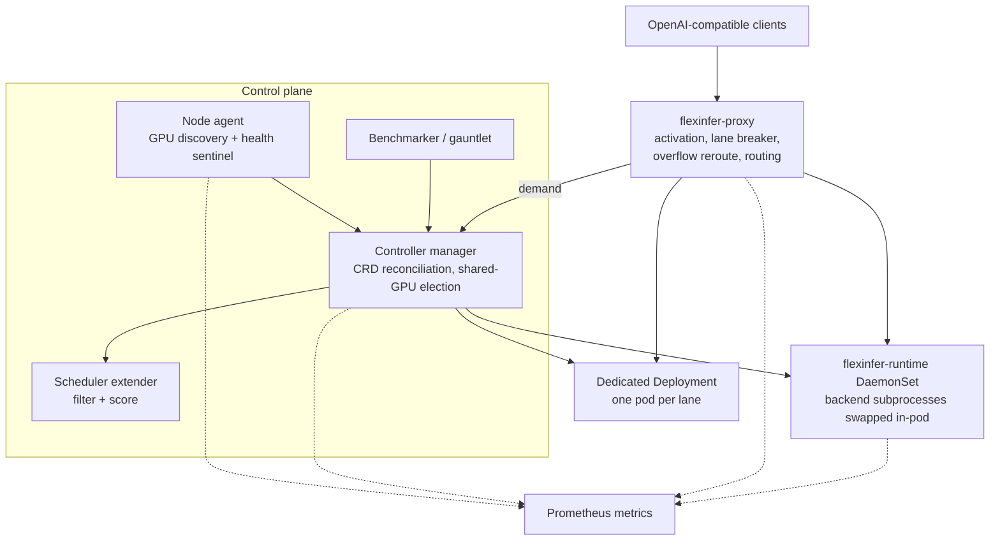

# FlexInfer

**A Kubernetes operator and OpenAI-compatible proxy for serving AI models on mixed GPUs**

FlexInfer turns a `Model` resource into a serving lane: it picks a GPU, stages the weights, starts a backend (vLLM, llama.cpp, diffusers and others), and puts the lane behind one OpenAI-compatible endpoint that scales it to zero when idle. Lanes that share a card take turns by priority and demand.

It is developed against a live homelab k3s cluster and runs that cluster's LLM, embedding, rerank, TTS, image and video lanes on AMD RX 7900 XTX (gfx1100), AMD Radeon VII (gfx906) and NVIDIA GTX 980 Ti (Maxwell) cards. The `master` branch is mirrored to [github.com/flexinfer/flexinfer](https://github.com/flexinfer/flexinfer). Issues and merge requests are tracked on [GitLab](https://gitlab.flexinfer.ai/services/flexinfer/-/issues).

## Current Status

As of 2026-10-29, `master` pins controller build `4ee89231` and proxy build `96242783` (commits `792fc0531`, `98f38789e`). October 2026 added:

- vLLM 0.32 with MTP speculative decoding and segmented attention on the gfx1100 workhorse.
- The proxy's context-overflow reroute and lane-breaker fixes.
- Cache markers that track download options.
- The GPU health sentinel.
- llama.cpp b11847 on gfx1100.
- A hardware-queue cap on gfx906.
- A Qwen-Image 2.1 lane.
- The stacked vLLM 0.32 runtime image for gfx1100, plus the controller pre-work for in-pod swaps.

[ROADMAP.md](ROADMAP.md) holds planned work. The research docs linked below hold the evidence behind each change.

## What It Does

**Operator (CRDs, group `ai.flexinfer`).** Reference: [docs/agents/model-crds.md](docs/agents/model-crds.md).

| Kind | Version | Purpose |
|---|---|---|
| `Model` | v1alpha2 | One resource per lane: backend, source, cache, GPU sharing, scale-to-zero, backend config ([docs/user/models-v1alpha2.md](docs/user/models-v1alpha2.md)) |
| `GPUProfile` | v1alpha2 | Per GPU architecture: VRAM, features, per-backend support and images, env, which backends the runtime pod bundles, digest-bound backend certificates |
| `LoRAAdapter` | v1alpha2 | Adapters hot-loaded into vLLM lanes |
| `ModelCatalog` | v1alpha2 | OCI model registry sources (Harbor, GHCR, ECR; `pkg/registry/`) |
| `ModelCache` | v1alpha1 | Standalone artifact staging plus the quantization, abliteration, fine-tune and publish pipelines |
| `ModelExperiment` | v1alpha2 | Runs an isolated candidate through the benchmark gauntlet and records a typed verdict without touching production Models ([docs/user/model-experiments.md](docs/user/model-experiments.md)) |
| `ModelBackfill` | v1alpha2 | Bounded CPU-side Jobs against an already-warm model during foreground-idle windows ([docs/user/model-backfill.md](docs/user/model-backfill.md)) |

The tree also carries `GamingSession`, `GPULease`, `WorkflowProfile` and the multi-cluster `Cluster` / `FederatedModel` / `GlobalProxy` kinds. The v1alpha1 `ModelDeployment` and `GPUGroup` kinds are deprecated ([docs/user/legacy-v1alpha1.md](docs/user/legacy-v1alpha1.md)).

**Node agent** (`flexinfer-agent`). Detects GPU vendor, architecture, VRAM and count and labels nodes (`flexinfer.ai/gpu.vendor`, `gpu.arch`, `gpu.vram`, `gpu.count`). Its **GPU health sentinel** checks each card through sysfs with bounded tool timeouts and sets `flexinfer.ai/gpu.health=ok|degraded`. The scheduler extender then rejects a degraded node, and the controller parks that node's lanes (`Schedulable=False/GPUDegraded`) until the card recovers ([docs/agents/operations.md](docs/agents/operations.md#gpu-health-sentinel)).

**Shared-GPU election.** Models with the same `spec.gpu.shared` group time-share a card. The controller elects the active member from priority and recent demand. On profiles with `features.multiModel`, several members can stay resident at once within the card's VRAM budget ([docs/user/gpu-sharing.md](docs/user/gpu-sharing.md)).

**flexinfer-proxy.** One OpenAI-compatible endpoint for every lane ([docs/user/proxy.md](docs/user/proxy.md), [docs/user/routing.md](docs/user/routing.md)):

- **Scale-to-zero activation.** A request to an idle lane records demand and is held in a queue while the lane warms.
- **Lane breaker.** Each lane has a first-byte budget: 120 s by default, overridable per Model with `flexinfer.ai/lane-first-byte-budget`. A lane that stays silent past it counts as failed, and repeated failures open the breaker. Lanes that serve neither chat nor embeddings (images, audio, rerank) are probed on `GET /health`. A client that cancels early no longer counts against the lane.
- **Context-overflow reroute.** A Model annotated `flexinfer.ai/context-overflow-to: <model>` hands a prompt that exceeds its window to a larger-window lane. The replay runs under the target lane's own budget and breaker ([routing.md](docs/user/routing.md#context-overflow-context-overflow-to)).
- **Routing.** Session affinity, prefix routing and least-loaded routing across lanes that share a service label. Proxy rollouts drain readiness-first.

**Two serving paths** (next section) and a **cache layer**:

- `spec.cache.strategy` is one of `Local`, `SharedPVC`, `Memory` or `None`. Its completion markers hash the source together with the download options (`ggufFile`, allow and ignore patterns, `hfRevision`), so changing the file set re-stages the cache. A legacy marker is adopted when the staged files still satisfy the options ([docs/user/caching.md](docs/user/caching.md)).
- `spec.cache.compilationCache` keeps the Triton, TorchInductor, vLLM and MIOpen caches per lane on a node hostPath, `<hostPath>/<namespace>/<model>`, with the default base `/var/lib/flexinfer/compile-cache`.

**Benchmarks.** `flexinfer-bench` and the benchmark gauntlet measure throughput and chat-aware coherence ([docs/user/gauntlet.md](docs/user/gauntlet.md)).

## Serving Paths

A Model is served one of two ways:

| | Dedicated Deployment | Runtime DaemonSet |
|---|---|---|
| Shape | One Deployment per lane, image pinned per Model | One `flexinfer-runtime` pod per node, running the GPU class's runtime image |
| Swapping lanes on a shared card | Scale one Deployment to 0, then the next to 1 (pod churn) | The controller asks the runtime supervisor (`cmd/flexinfer-runtime`, `internal/runtime/`) to unload one backend subprocess and load another, with VRAM admission |
| Used when | The backend is not in the GPUProfile's `runtime.bundledBackends`, the Model sets `config.dedicatedDeployment: true`, the source is `pvc://`, or the Model is CPU-only | The backend is bundled and the node runs a runtime pod |
| Extras | Per-lane image pins, flash-loader, KV-pool recheck | Multi-model co-residence (`FLEXINFER_RUNTIME_MULTI_MODEL`), request drain before a swap (`FLEXINFER_RUNTIME_REQUEST_DRAIN`), in-pod reload on a spec edit, in-pod loading substage and KV-pool recheck |

A runtime pod ignores a Model's `image`: every lane it hosts runs the DaemonSet's image. Eligibility is decided in `pkg/runtime/payload.go`.

## Unified Runtime Image

**Direction.** Each GPU class gets one stacked runtime image that carries every backend the class serves. On gfx1100 that means vLLM, diffusers and snac; on gfx906 it means llama.cpp, ollama and diffusers. With one image per class, the controller swaps lanes inside the runtime pod through the `flexinfer-runtime` supervisor instead of churning Kubernetes pods. This has been the owner's stated direction since 2026-10-24 ([research §7e](.loom/10-research-gfx1100-next-feature-2026-10-23.md), [serving-gaps review §3](.loom/10-research-serving-gaps-switching-caching-2026-10-27.md)).

**Why.** Measured over 30 days to 2026-10-27 ([serving-gaps review §2](.loom/10-research-serving-gaps-switching-caching-2026-10-27.md)):

- An in-pod llama.cpp swap on the Radeon VII takes 3.5 to 9.2 s (p50 3.5–5.6 s, p95 9.2 s, 16 swaps).
- A dedicated 27B vLLM lane on the 5930k averages a 767 s (~13 min) cold start.

**Where it stands:**

| GPU class | Runtime image | State |
|---|---|---|
| gfx906 (Radeon VII) | `runtime:rocm-gfx906`, CI build `90648c35`: llama.cpp b11335, ollama, diffusers | **In place.** The Radeon VII's llama.cpp lanes are served in-pod, with multi-model and request drain on. Its one vLLM lane, the openjev cross-encoder, runs as a dedicated Deployment because this image does not bundle vLLM. |
| gfx1100 (RX 7900 XTX) | Built, not yet serving: profile `gfx1100-serving-v032` (`build/Dockerfile.runtime-serving-v032`), CI digest `ef28b7b0`. It holds vLLM 0.32 with the native W4A16 plugins, the supervisor, diffusers 0.42 and snac. The build freezes the vLLM stack with pip constraints and checks every spawn target (`build/scripts/verify_runtime_serving_stack.py`). | **Pre-work merged and rolled** (controller `4ee89231`). Shipped: in-pod reload on spec change (`generation` + `specHash`), request drain on both gfx1100 runtime profiles, multi-model on the 5930k profile, an in-pod loading substage with KV-pool recheck, and cold-start and swap histograms labelled `serving_path` (buckets to 1800 s and 900 s). The runtime half of reload and substage reporting ships in the supervisor binary, and `ef28b7b0` was built before those merges. **Today**, both gfx1100 runtime DaemonSets still run the `gfx1100-serving` persona `cfefae18` (vLLM 0.17). The 5930k DaemonSet is parked at desired=0 with `ef28b7b0` prewarmed on that node, and the XTX runtime pod hosts only the snac decode lane. Every gfx1100 text lane is a dedicated Deployment. |
| Maxwell (GTX 980 Ti) | none | Dedicated pods only, by decision on 2026-10-12 ([docs/agents/gpu-compatibility.md](docs/agents/gpu-compatibility.md#maxwell-runtime-posture-gtx-980-ti)). |

**Next** ([research §7e](.loom/10-research-gfx1100-next-feature-2026-10-23.md), [serving-gaps review §8](.loom/10-research-serving-gaps-switching-caching-2026-10-27.md)):

- **S6b.** Un-park the 5930k runtime on the stacked 0.32 image and move the workhorse in-pod. The pass bar: greedy hashes identical to the dedicated pod, decode within 3 % at 512, 2K and 16K tokens, and a workhorse ↔ 9B-RP swap timed against today's pod churn.
- **S6c.** The 5930k lanes that opt out with `dedicatedDeployment` drop the opt-out one at a time. The MTP lanes move their env from command wrappers into `spec.config.env`, because the runtime load payload carries no command.
- **S6d.** The XTX DaemonSet moves to the same persona once its lanes qualify.
- **S6e.** bitsandbytes on ROCm 7.2 and the Qwen-Image 2.1 diffusers checks land in this image, so that lane can move in-pod too.

## What Runs Where

Lane manifests live in [deploy/models/](deploy/models/), GPU profiles in [deploy/gpuprofiles/](deploy/gpuprofiles/), and runtime build profiles in [build/runtime.yaml](build/runtime.yaml). Measurements are in [.loom/60-validation-matrix.md](.loom/60-validation-matrix.md).

| GPU class / node | What it serves | How |
|---|---|---|
| gfx1100, `cblevins-5930k` | **Qwen3.8-27B workhorse** on vLLM 0.32 (`runtime@b06b06fe`, profile `gfx1100-native-w4a16`) with the RDNA3 W4A16 GPTQ kernel, `ROCM_SEGMENTED_ATTN`, fp16 KV and MTP K=2 at 32K. At promotion (2026-10-26) it measured 68.5 / 65.9 tok/s at 2K / 16K tokens and 0.82 position-0 draft acceptance ([research §7f](.loom/10-research-gfx1100-next-feature-2026-10-23.md)). Prompts over 32K overflow to the XTX lane. On-demand lanes in the same shared group: Qwen-Image 2.1 (diffusers, NF4 on load), Wan 2.1 text- and image-to-video, stable-audio, and the Muse Glimmer 30B tools lane on llama.cpp b11847 | Dedicated Deployments (the runtime DaemonSet is parked) |
| gfx1100, `cblevins-7900xtx` | Warm Qwen3.8-27B lane at 64K with fp8 KV and `TRITON_ATTN` on the same 0.32 image. It is the overflow target, with a 480 s first-byte budget. The runtime pod hosts the snac voice-decode lane. This card drops off the PCIe bus under sustained load and is under hardware investigation. The health sentinel parks its lanes when it does. | Dedicated Deployment, plus the runtime pod on `cfefae18` |
| gfx906, `cblevins-radeonvii` | The retrieval and TTS plane on llama.cpp: bge-large embeddings, bge-reranker, gte-Qwen2-1.5B, Qwen3-Embedding-4B, Qwen3-Reranker-0.6B, Orpheus-3B TTS and the Humanizer rewrite lane. The profile sets `GPU_MAX_HW_QUEUES=1` so co-resident llama-servers stay inside the card's 24 hardware compute queues ([docs/dev/gfx906-gpu-support.md](docs/dev/gfx906-gpu-support.md)) | In-pod, runtime DaemonSet `90648c35` (the vLLM openjev cross-encoder is a dedicated Deployment) |
| Maxwell sm_52, `cblevins-gtx980ti` | Dreamshaper 8 (SD 1.5) image generation on the CUDA 11.8 diffusers image | Dedicated Deployment |

On gfx1100, llama.cpp `draft-mtp` speculation is certified for the b11847 image behind a digest-bound GPUProfile certificate. No lane opts in yet (`deploy/gpuprofiles/gfx1100.yaml`).

## Architecture



The backend registry (`backend/`) holds each backend's image, port, arguments, environment and probes. It covers vLLM, vLLM-Omni, llama.cpp, ollama, diffusers, snac, ComfyUI and MLC-LLM, plus the gaming-mode personas.

Component reference: [docs/agents/components.md](docs/agents/components.md). Workflow diagrams (reconciliation, proxy routing, GPU sharing, scheduling): [docs/dev/architecture.md](docs/dev/architecture.md). Doc index: [docs/README.md](docs/README.md).

## Quick Start

### Prerequisites

- Kubernetes 1.26+ (the chart's `kubeVersion`)
- GPU nodes with drivers and the vendor device plugin (`amd.com/gpu` or `nvidia.com/gpu`)
- Prometheus (optional, for metrics and the chart's alerts)

### Installation

```bash
helm upgrade --install flexinfer charts/flexinfer \
  --namespace flexinfer-system \
  --create-namespace
```

Full guides: [docs/INSTALL.md](docs/INSTALL.md), [docs/user/quickstart.md](docs/user/quickstart.md), [docs/user/operations.md](docs/user/operations.md).

### A Model

```yaml
apiVersion: ai.flexinfer/v1alpha2
kind: Model
metadata:
  name: bge-large
spec:
  backend: llamacpp
  source: HF://CompendiumLabs/bge-large-en-v1.5-gguf
  cache:
    strategy: Local
  gpu:
    vendor: amd
    shared: my-gpu         # Models with the same group time-share one card
    priority: 120          # higher wins the card under contention
    vramEstimateMB: 1500
  serverless:
    enabled: true
    minReplicas: 0         # scale to zero when idle
    idleTimeout: 30m
  config:
    ggufFile: bge-large-en-v1.5-q8_0.gguf
    embedding: true
```

This is a trimmed copy of the live `deploy/models/bge-radeonvii.yaml`. When a request for the higher-priority member of a `gpu.shared` group arrives, the active lower-priority member is preempted. More examples are in [examples/v1alpha2/](examples/v1alpha2/).

### Backends

| Backend | Port | Typical use |
|---|---|---|
| `vllm` | 8000 | High-throughput text, OpenAI API |
| `llamacpp` | 8080 | GGUF text, embeddings and rerank on GPU or CPU |
| `diffusers` | 8000 | Image and video generation (`server-diffusers.py`) |
| `snac` | 8000 | SNAC waveform decode for TTS (runtime-pod subprocess) |
| `ollama` | 11434 | Pull-on-demand models |
| `vllm-omni` | 8000 | Multimodal / diffusion models behind the OpenAI API |
| `comfyui` | 8188 | Workflow-based image generation |
| `mlc-llm` | 8000 | Kept in the registry; no lane in this fleet has used it since the MLC serving era was retired (2026-08) |

CPU-only inference:

- Set `spec.gpu.vendor: cpu` and omit `spec.gpu.count`.
- For `llamacpp` with `HF://` GGUF repos, set `spec.config.ggufFile` to pick the file. The prefetch is selective: it downloads that file and an optional relative `mmproj`, not the whole repo.
- Optional download controls: `hfAllowPatterns`, `hfIgnorePatterns`, `hfRevision` (pin it to a full commit SHA).
- See [docs/user/backends-cpu.md](docs/user/backends-cpu.md).

## GPU Notes

Per-architecture backend support: [docs/agents/gpu-compatibility.md](docs/agents/gpu-compatibility.md).

- **gfx1100 (RX 7900 XTX):** [docs/user/backends-rocm-gfx1100.md](docs/user/backends-rocm-gfx1100.md). The current images build on ROCm 7.2 (`build/runtime.yaml`). SDXL needs the `madebyollin/sdxl-vae-fp16-fix` VAE ([runbook](docs/DEPLOYMENT_RUNBOOK.md#11-sdxl-vae-fp16-nan-on-rocm-gfx1100-amd-rdna3)).
- **gfx906 (Radeon VII):** [docs/dev/gfx906-gpu-support.md](docs/dev/gfx906-gpu-support.md).
- **Maxwell (GTX 980 Ti):** [docs/user/backends-maxwell.md](docs/user/backends-maxwell.md), [build/README-maxwell.md](build/README-maxwell.md).

Mixed-vendor clusters:

- Set `spec.gpu.vendor` explicitly when a cluster has both AMD and NVIDIA nodes.
- NVIDIA workloads usually need `runtimeClassName: nvidia` to get `/dev/nvidia*` injected.
- ROCm workloads need `/dev/kfd` and `/dev/dri`. If `rocm-smi` is missing in the agent container, the agent falls back to sysfs, plus `rocminfo` when present, to infer `gfx*`.

Sanity checks:

```bash
# GPU resources advertised by the device plugins
kubectl describe node <node> | rg -n "nvidia.com/gpu|amd.com/gpu"

# Agent labels (vendor + arch are the key selectors) and GPU health
kubectl get nodes -L flexinfer.ai/gpu.vendor -L flexinfer.ai/gpu.arch -L flexinfer.ai/gpu.vram -L flexinfer.ai/gpu.count -L flexinfer.ai/gpu.health

# VRAM telemetry used for headroom scoring
kubectl get nodes -o custom-columns='NAME:.metadata.name,FREE_MB:.metadata.annotations.flexinfer\.ai/gpu-free-memory,UTIL:.metadata.annotations.flexinfer\.ai/gpu\.util'
```

If scheduling looks random in a mixed cluster, start with [docs/user/operations.md](docs/user/operations.md). Its runtimeClass and device-plugin checks cover the usual causes.

## Development

```bash
make build          # manager binary (runs manifests, generate, fmt, vet)
make build-all      # manager, CLI, agent, bench, proxy, global proxy, scheduler, flash-loader, agent-loop
make test           # unit + envtest suite
make test-unit      # unit tests only (no envtest)
make manifests      # regenerate CRDs and copy them into the Helm chart

# Runtime images, one profile from build/runtime.yaml
./build/build-runtime.sh gfx1100-serving-v032 --dry-run
```

`make help` lists every target. Runtime digest promotion is documented in [docs/dev/runtime-digest-promotion.md](docs/dev/runtime-digest-promotion.md), and the local setup in [docs/dev/local-dev.md](docs/dev/local-dev.md).

## Roadmap and Research

- [ROADMAP.md](ROADMAP.md): Now / Next / Later. Its backlog is in [GitLab issues](https://gitlab.flexinfer.ai/services/flexinfer/-/issues).
- [.loom/10-research-gfx1100-next-feature-2026-10-23.md](.loom/10-research-gfx1100-next-feature-2026-10-23.md): the October gfx1100 program, slices S1 to S6.
- [.loom/10-research-serving-gaps-switching-caching-2026-10-27.md](.loom/10-research-serving-gaps-switching-caching-2026-10-27.md): serving gaps, in-pod switching and the cache stack, with the ranked plan.
- [.loom/20-product-spec-runtime-image-ci-2026-09-13.md](.loom/20-product-spec-runtime-image-ci-2026-09-13.md): runtime images built and promoted by CI (issue #74).
- [.loom/60-validation-matrix.md](.loom/60-validation-matrix.md): dated qualification rows behind every promotion.

## Contributing

See [CONTRIBUTING.md](CONTRIBUTING.md), [GOVERNANCE.md](GOVERNANCE.md) and [SECURITY.md](SECURITY.md).

## License

Apache 2.0. See [LICENSE](LICENSE).
