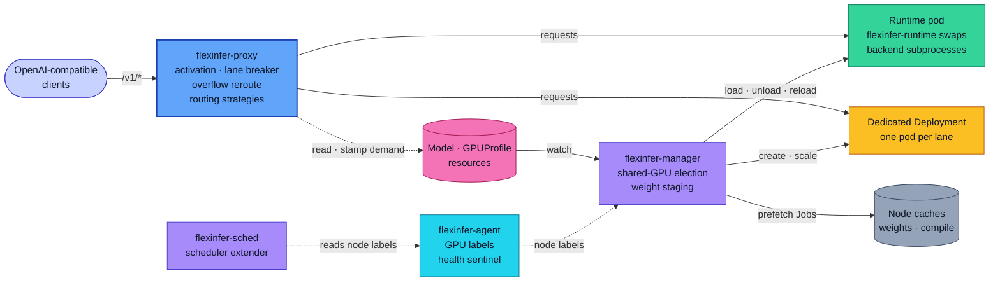
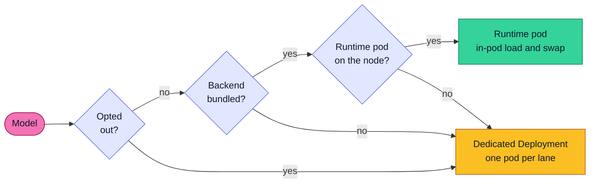

# FlexInfer

**A Kubernetes operator and OpenAI-compatible proxy for serving LLM, image and audio models on mixed consumer GPUs.**

FlexInfer turns a `Model` resource into a serving lane. It picks a GPU, stages the weights, starts a backend (vLLM, llama.cpp, diffusers and others), and puts the lane behind one OpenAI-compatible endpoint that scales it to zero when idle. Lanes that share a card take turns by priority and demand.

It is developed against a live homelab k3s cluster and runs that cluster's LLM, embedding, rerank, TTS, image and video lanes on AMD RX 7900 XTX (gfx1100), AMD Radeon VII (gfx906) and NVIDIA GTX 980 Ti (Maxwell) cards.

**Who it is for:** people who run Kubernetes on a few consumer GPUs and have more models than cards. FlexInfer gives them:

- One endpoint for chat, embeddings, rerank, speech, image and video, with idle lanes at zero replicas.
- Several lanes per card that hand the card over on demand, highest priority first.
- Per-architecture images, environment and backend certificates declared in `GPUProfile` resources rather than scripts.

The manifests under [deploy/](deploy/) are that one cluster's lanes, node names and registry. Read them as worked examples, not defaults.

The `master` branch is mirrored to [github.com/flexinfer/flexinfer](https://github.com/flexinfer/flexinfer). Issues and merge requests are tracked on [GitLab](https://gitlab.flexinfer.ai/services/flexinfer/-/issues).

**Contents:** [How it works](#how-it-works) · [Quick start](#quick-start) · [Serving paths](#serving-paths) · [Unified runtime image](#unified-runtime-image) · [GPU classes](#supported-gpu-classes) · [Cache layers](#cache-layers) · [Custom resources](#custom-resources) · [Documentation](#documentation) · [Status and roadmap](#status-and-roadmap)

## How it works



A request for an idle lane is held by the proxy, which stamps demand on the `Model`. The controller elects the lane onto its card, stages the weights, and either loads the lane into the node's runtime pod or scales up its Deployment. The proxy then forwards the held requests.

| Component | Binary | What it does |
|---|---|---|
| Controller | `flexinfer-manager` | Reconciles `Model`, `GPUProfile` and the other CRDs. Elects which lanes run on a shared card, stages weights, then serves each lane through the runtime pod or a dedicated Deployment. Parks lanes whose only node has a degraded GPU (`Schedulable=False/GPUDegraded`). |
| Proxy | `flexinfer-proxy` | One OpenAI-compatible endpoint for every lane. See the feature table below. |
| Runtime supervisor | `flexinfer-runtime` | One pod per GPU node. Starts, stops and swaps backend subprocesses inside the pod, with VRAM admission and request drain (`cmd/flexinfer-runtime`, `internal/runtime/`). |
| Node agent | `flexinfer-agent` | DaemonSet. Labels each node with GPU vendor, architecture, VRAM and count. Its GPU health sentinel checks every card through sysfs with bounded tool timeouts and sets `flexinfer.ai/gpu.health=ok\|degraded` ([operations](docs/agents/operations.md#gpu-health-sentinel)). |
| Scheduler extender | `flexinfer-sched` | `/filter` and `/score` for pods scheduled by the `flexinfer-scheduler` profile. Rejects degraded nodes and nodes short on free VRAM; scores on benchmark throughput and VRAM headroom ([spec](docs/specs/scheduler-extender.md)). |
| Flash loader | `flexinfer-flash-loader` | Optional init container on dedicated lane pods. Copies weights into node tmpfs in parallel before the backend starts ([caching](docs/user/caching.md#flash-loader)). |
| Benchmarks | `flexinfer-bench` | Throughput runs and the benchmark gauntlet with chat-aware coherence checks ([gauntlet](docs/user/gauntlet.md)). |

### Proxy features

| Feature | Behaviour | Configure with |
|---|---|---|
| Scale-to-zero activation | A request to an idle lane records demand and waits in a bounded queue while the lane warms. | `spec.serverless` |
| Lane breaker | Each lane has a first-byte budget, 120 s by default. Three consecutive failures (the default threshold) open the breaker. Requests then get a 503 with `Retry-After` until a probe succeeds. Lanes that serve neither chat nor embeddings (images, audio, rerank) are probed on `GET /health`. A client that cancels after the first byte does not count against the lane. | `flexinfer.ai/lane-first-byte-budget` |
| Context-overflow reroute | When a lane rejects a prompt as longer than its window, the proxy replays it once to a larger-window lane. The replay runs under the target lane's own budget and breaker ([routing](docs/user/routing.md#context-overflow-context-overflow-to)). | `flexinfer.ai/context-overflow-to: <model>` |
| Routing | Session-affinity, prefix and least-loaded strategies across a lane's ready pods. Round-robin across Ready lanes that claim the same service label. Proxy rollouts drain readiness-first. | `flexinfer.ai/routing` |

Proxy reference: [docs/user/proxy.md](docs/user/proxy.md), [docs/user/routing.md](docs/user/routing.md), [docs/specs/proxy-api.md](docs/specs/proxy-api.md). Workflow diagrams for reconciliation, routing, GPU sharing and scheduling: [docs/dev/architecture.md](docs/dev/architecture.md).

## Quick start

**Prerequisites**

- Kubernetes 1.26+ (the chart's `kubeVersion`).
- GPU nodes with drivers and the vendor device plugin (`amd.com/gpu` or `nvidia.com/gpu`).
- Prometheus, optionally, for metrics and the chart's alerts.

**1. Install the operator, proxy, agent and scheduler extender**

```bash
helm upgrade --install flexinfer charts/flexinfer \
  --namespace flexinfer-system \
  --create-namespace
```

**2. Declare a Model**

```yaml
apiVersion: ai.flexinfer/v1alpha2
kind: Model
metadata:
  name: bge-large
  namespace: flexinfer-system
spec:
  backend: llamacpp
  source: HF://CompendiumLabs/bge-large-en-v1.5-gguf
  cache:
    strategy: Local
  gpu:
    vendor: amd
    shared: my-gpu         # Models with the same group time-share one card
    priority: 120          # higher wins the card under contention
    vramEstimateMB: 1500
  serverless:
    enabled: true
    minReplicas: 0         # scale to zero when idle
    idleTimeout: 30m
  config:
    ggufFile: bge-large-en-v1.5-q8_0.gguf
    embedding: true
  nodeSelector:
    kubernetes.io/hostname: <gpu-node>   # a Local cache is staged on one node
```

This is adapted from the live [deploy/models/bge-radeonvii.yaml](deploy/models/bge-radeonvii.yaml), which also sets resources, context size and LiteLLM aliases, and keeps one replica warm. When a request for the higher-priority member of a `gpu.shared` group arrives, the active lower-priority member is preempted. More examples are in [examples/v1alpha2/](examples/v1alpha2/).

**3. Call it through the proxy**

```bash
kubectl -n flexinfer-system get models -w        # watch the lane's phase
kubectl -n flexinfer-system port-forward svc/flexinfer-proxy 8080:80

curl -s http://127.0.0.1:8080/v1/embeddings \
  -H 'Content-Type: application/json' \
  -d '{"model": "bge-large", "input": "hello"}'
```

The first request after an idle period waits while the lane activates. Full guides: [docs/INSTALL.md](docs/INSTALL.md), [docs/user/quickstart.md](docs/user/quickstart.md), [docs/user/operations.md](docs/user/operations.md).

### Backends

The backend registry (`backend/`) holds each backend's image, port, arguments, environment and probes.

| Backend | Port | Typical use |
|---|---|---|
| `vllm` | 8000 | High-throughput text, OpenAI API |
| `llamacpp` | 8080 | GGUF text, embeddings and rerank on GPU or CPU |
| `diffusers` | 8000 | Image and video generation (`server-diffusers.py`) |
| `snac` | 8000 | SNAC waveform decode for TTS (runtime-pod subprocess) |
| `ollama` | 11434 | Pull-on-demand models |
| `vllm-omni` | 8000 | Multimodal and diffusion models behind the OpenAI API |
| `comfyui` | 8188 | Workflow-based image generation |
| `mlc-llm` | 8000 | Kept in the registry; no lane in this fleet has used it since the MLC serving era was retired (2026-08) |

The registry also carries the gaming-mode personas.

<details>
<summary><b>CPU-only inference</b></summary>

- Set `spec.gpu.vendor: cpu` and omit `spec.gpu.count`.
- For `llamacpp` with `HF://` GGUF repos, set `spec.config.ggufFile` to pick the file. The prefetch is selective: it downloads that file and an optional relative `mmproj`, not the whole repo.
- Optional download controls: `hfAllowPatterns`, `hfIgnorePatterns`, `hfRevision` (pin it to a full commit SHA).
- See [docs/user/backends-cpu.md](docs/user/backends-cpu.md).

</details>

## Serving paths

Every lane is served one of two ways. The controller decides per Model in `pkg/runtime/payload.go` and `controllers/model_controller.go`:



- **Opted out:** the Model sets `config.dedicatedDeployment: true`, sets `gpu.vendor: cpu`, or has a raw `pvc://` source without a `Local` cache.
- **Backend bundled:** the backend is listed in the node's GPUProfile under `runtime.bundledBackends`.
- **Runtime pod on the node:** a `flexinfer-runtime` pod runs on the Model's node. If it exists but is still starting, the controller waits for it rather than creating a Deployment.

| | Runtime pod (DaemonSet) | Dedicated Deployment |
|---|---|---|
| Shape | One `flexinfer-runtime` pod per node, running the GPU class's runtime image | One Deployment per lane, image pinned per Model |
| Lane swap on a shared card | The controller asks the supervisor to unload one backend subprocess and load the next, with VRAM admission | Scale one Deployment to 0, then the next to 1 (pod churn) |
| Image | The DaemonSet's image; a Model's `image` is ignored | The Model's own image, pinned per lane |
| Extras | Multi-model co-residence (`FLEXINFER_RUNTIME_MULTI_MODEL`), request drain before a swap (`FLEXINFER_RUNTIME_REQUEST_DRAIN`), in-pod reload on a spec edit, in-pod loading substage, KV-pool recheck | Flash loader, KV-pool recheck |

**Shared-GPU election.** Models with the same `spec.gpu.shared` group time-share a card, on either path. The controller elects the active member from priority and recent demand, with a swap cooldown against thrashing. On profiles with `features.multiModel`, several members can stay resident at once within the card's VRAM budget ([docs/user/gpu-sharing.md](docs/user/gpu-sharing.md)).

## Unified runtime image

**Direction.** Each GPU class gets one stacked runtime image that carries every backend the class serves. On gfx1100 that means vLLM, diffusers and snac; on gfx906 it means llama.cpp, ollama and diffusers. With one image per class, the controller swaps lanes inside the runtime pod through the `flexinfer-runtime` supervisor instead of churning Kubernetes pods. This has been the owner's stated direction since 2026-10-24 ([research §7e](.loom/10-research-gfx1100-next-feature-2026-10-23.md), [serving-gaps review §3](.loom/10-research-serving-gaps-switching-caching-2026-10-27.md)).

**Why.** Measured over 30 days to 2026-10-27 ([serving-gaps review §2](.loom/10-research-serving-gaps-switching-caching-2026-10-27.md)):

| Path | Measured |
|---|---|
| In-pod llama.cpp swap on the Radeon VII | 3.5 to 9.2 s (p50 3.5–5.6 s, p95 9.2 s, 16 swaps) |
| Cold start of a dedicated 27B vLLM lane on the 5930k | 767 s average (~13 min) |

**Where it stands:**

| GPU class | Runtime image | State |
|---|---|---|
| gfx906 (Radeon VII) | `runtime:rocm-gfx906`, CI build `90648c35`: llama.cpp b11335, ollama, diffusers | **In place.** The Radeon VII's llama.cpp lanes are served in-pod, with multi-model and request drain on. Its one vLLM lane, the openjev cross-encoder, runs as a dedicated Deployment because this image does not bundle vLLM. |
| gfx1100 (RX 7900 XTX) | Built, not yet serving: profile `gfx1100-serving-v032` (`build/Dockerfile.runtime-serving-v032`), CI digest `ef28b7b0`. vLLM 0.32 with the native W4A16 plugins, the supervisor, diffusers 0.42 and snac. The build freezes the vLLM stack with pip constraints and checks every spawn target (`build/scripts/verify_runtime_serving_stack.py`). | **Pre-work merged and rolled** (controller `4ee89231`). **Today** both gfx1100 runtime DaemonSets still run the `gfx1100-serving` persona `cfefae18` (vLLM 0.17). The 5930k DaemonSet is parked at desired=0 with `ef28b7b0` prewarmed on that node; the XTX runtime pod hosts only the snac decode lane. Every gfx1100 text lane is a dedicated Deployment. |
| Maxwell (GTX 980 Ti) | none | Dedicated pods only, by decision on 2026-10-12 ([gpu-compatibility](docs/agents/gpu-compatibility.md#maxwell-runtime-posture-gtx-980-ti)). |

<details>
<summary><b>gfx1100 pre-work already shipped</b></summary>

- In-pod reload on a spec change (`generation` + `specHash`).
- Request drain on both gfx1100 runtime profiles, and multi-model on the 5930k profile.
- An in-pod loading substage with KV-pool recheck.
- Cold-start and swap histograms labelled `serving_path` (buckets to 1800 s and 900 s).

The runtime half of reload and substage reporting ships in the supervisor binary, and `ef28b7b0` was built before those merges.

</details>

**Next (roadmap)** ([research §7e](.loom/10-research-gfx1100-next-feature-2026-10-23.md), [serving-gaps review §8](.loom/10-research-serving-gaps-switching-caching-2026-10-27.md)):

| Step | Plan |
|---|---|
| S6b | Un-park the 5930k runtime on the stacked 0.32 image and move the workhorse in-pod. Pass bar: greedy hashes identical to the dedicated pod, decode within 3 % at 512, 2K and 16K tokens, and a workhorse ↔ 9B-RP swap timed against today's pod churn. |
| S6c | The 5930k lanes that opt out with `dedicatedDeployment` drop the opt-out one at a time. The MTP lanes move their env from command wrappers into `spec.config.env`, because the runtime load payload carries no command. |
| S6d | The XTX DaemonSet moves to the same persona once its lanes qualify. |
| S6e | bitsandbytes on ROCm 7.2 and the Qwen-Image 2.1 diffusers checks land in this image, so that lane can move in-pod too. |

## Supported GPU classes

Per-architecture backend support: [docs/agents/gpu-compatibility.md](docs/agents/gpu-compatibility.md). GPU profiles: [deploy/gpuprofiles/](deploy/gpuprofiles/). Runtime build profiles: [build/runtime.yaml](build/runtime.yaml).

| GPU class | Cards in the reference cluster | Serving today | Guide |
|---|---|---|---|
| **gfx1100** · RDNA3 | RX 7900 XTX on `cblevins-5930k` and `cblevins-7900xtx` | Text, image, video and audio lanes as dedicated Deployments; the XTX runtime pod hosts the snac decode lane. Images build on ROCm 7.2. | [backends-rocm-gfx1100.md](docs/user/backends-rocm-gfx1100.md) |
| **gfx906** · Vega 20 | Radeon VII on `cblevins-radeonvii` | Retrieval and TTS lanes in-pod on llama.cpp; one vLLM cross-encoder as a dedicated Deployment | [gfx906-gpu-support.md](docs/dev/gfx906-gpu-support.md) |
| **sm_52** · NVIDIA Maxwell | GTX 980 Ti on `cblevins-gtx980ti` | Dedicated Deployments only | [backends-maxwell.md](docs/user/backends-maxwell.md), [build/README-maxwell.md](build/README-maxwell.md) |

<details>
<summary><b>What runs where</b> (lanes, images and measurements per node)</summary>

Lane manifests live in [deploy/models/](deploy/models/). Measurements are in [.loom/60-validation-matrix.md](.loom/60-validation-matrix.md).

| GPU class / node | What it serves | How |
|---|---|---|
| gfx1100, `cblevins-5930k` | **Qwen3.8-27B workhorse** on vLLM 0.32 (`runtime@b06b06fe`, profile `gfx1100-native-w4a16`) with the RDNA3 W4A16 GPTQ kernel, `ROCM_SEGMENTED_ATTN`, fp16 KV and MTP K=2 at 32K. At promotion (2026-10-26) it measured 68.5 / 65.9 tok/s at 2K / 16K tokens and 0.82 position-0 draft acceptance ([research §7f](.loom/10-research-gfx1100-next-feature-2026-10-23.md)). Prompts over 32K overflow to the XTX lane. On-demand lanes in the same shared group: Qwen-Image 2.1 (diffusers, NF4 on load), Wan 2.1 text- and image-to-video, stable-audio, and the Muse Glimmer 30B tools lane on llama.cpp b11847 | Dedicated Deployments (the runtime DaemonSet is parked) |
| gfx1100, `cblevins-7900xtx` | Warm Qwen3.8-27B lane at 64K with fp8 KV and `TRITON_ATTN` on the same 0.32 image. It is the overflow target, with a 480 s first-byte budget. The runtime pod hosts the snac voice-decode lane. This card drops off the PCIe bus under sustained load and is under hardware investigation. The health sentinel parks its lanes when it does. | Dedicated Deployment, plus the runtime pod on `cfefae18` |
| gfx906, `cblevins-radeonvii` | The retrieval and TTS plane on llama.cpp: bge-large embeddings, bge-reranker, gte-Qwen2-1.5B, Qwen3-Embedding-4B, Qwen3-Reranker-0.6B, Orpheus-3B TTS and the Humanizer rewrite lane. The profile sets `GPU_MAX_HW_QUEUES=1` so co-resident llama-servers stay inside the card's 24 hardware compute queues ([docs/dev/gfx906-gpu-support.md](docs/dev/gfx906-gpu-support.md)) | In-pod, runtime DaemonSet `90648c35` (the vLLM openjev cross-encoder is a dedicated Deployment) |
| Maxwell sm_52, `cblevins-gtx980ti` | Dreamshaper 8 (SD 1.5) image generation on the CUDA 11.8 diffusers image | Dedicated Deployment |

On gfx1100, llama.cpp `draft-mtp` speculation is certified for the b11847 image behind a digest-bound GPUProfile certificate. No lane opts in yet (`deploy/gpuprofiles/gfx1100.yaml`). SDXL on gfx1100 needs the `madebyollin/sdxl-vae-fp16-fix` VAE ([runbook](docs/DEPLOYMENT_RUNBOOK.md#11-sdxl-vae-fp16-nan-on-rocm-gfx1100-amd-rdna3)).

</details>

<details>
<summary><b>Mixed-vendor clusters and sanity checks</b></summary>

- Set `spec.gpu.vendor` explicitly when a cluster has both AMD and NVIDIA nodes.
- NVIDIA workloads usually need `runtimeClassName: nvidia` to get `/dev/nvidia*` injected.
- ROCm workloads need `/dev/kfd` and `/dev/dri`. If `rocm-smi` is missing in the agent container, the agent falls back to sysfs, plus `rocminfo` when present, to infer `gfx*`.

```bash
# GPU resources advertised by the device plugins
kubectl describe node <node> | rg -n "nvidia.com/gpu|amd.com/gpu"

# Agent labels (vendor + arch are the key selectors) and GPU health
kubectl get nodes -L flexinfer.ai/gpu.vendor -L flexinfer.ai/gpu.arch -L flexinfer.ai/gpu.vram -L flexinfer.ai/gpu.count -L flexinfer.ai/gpu.health

# VRAM telemetry used for headroom scoring
kubectl get nodes -o custom-columns='NAME:.metadata.name,FREE_MB:.metadata.annotations.flexinfer\.ai/gpu-free-memory,UTIL:.metadata.annotations.flexinfer\.ai/gpu\.util'
```

If scheduling looks random in a mixed cluster, start with [docs/user/operations.md](docs/user/operations.md). Its runtimeClass and device-plugin checks cover the usual causes.

</details>

## Cache layers

| Layer | Where it lives | What it holds | Set by |
|---|---|---|---|
| Weights cache | Node hostPath (`Local`), a PVC shared across nodes (`SharedPVC`), node RAM (`Memory`), or nothing (`None`) | Staged model files. Completion markers hash the source together with the download options (`ggufFile`, allow and ignore patterns, `hfRevision`), so changing the file set re-stages the cache. A legacy marker is adopted when the staged files still satisfy the options. | `spec.cache.strategy` |
| Flash-loader tmpfs | `/dev/shm/flexinfer/<namespace>/<model>` for shared lanes, an `emptyDir` tmpfs otherwise | A copy of the weights made before a dedicated lane's backend starts, so a swap avoids slow volume reads | `spec.cache.flashLoader` |
| Compile cache | Node hostPath `<hostPath>/<namespace>/<model>`, default base `/var/lib/flexinfer/compile-cache` | Triton, TorchInductor, vLLM and MIOpen caches per lane | `spec.cache.compilationCache` |
| Model registry | Harbor, GHCR or ECR | OCI-packaged model artifacts (`pkg/registry/`) | `ModelCatalog` |

Guides: [docs/user/caching.md](docs/user/caching.md), [docs/user/caching-oci.md](docs/user/caching-oci.md).

## Custom resources

All kinds are in the API group `ai.flexinfer`. Reference: [docs/agents/model-crds.md](docs/agents/model-crds.md).

| Kind | Version | Purpose |
|---|---|---|
| `Model` | v1alpha2 | One resource per lane: backend, source, cache, GPU sharing, scale-to-zero, backend config ([docs/user/models-v1alpha2.md](docs/user/models-v1alpha2.md)) |
| `GPUProfile` | v1alpha2 | Per GPU architecture: VRAM, features, per-backend support and images, env, which backends the runtime pod bundles, digest-bound backend certificates |
| `LoRAAdapter` | v1alpha2 | Adapters hot-loaded into vLLM lanes |
| `ModelCatalog` | v1alpha2 | OCI model registry sources (Harbor, GHCR, ECR; `pkg/registry/`) |
| `ModelCache` | v1alpha1 | Standalone artifact staging plus the quantization, abliteration, fine-tune and publish pipelines |
| `ModelExperiment` | v1alpha2 | Runs an isolated candidate through the benchmark gauntlet and records a typed verdict without touching production Models ([docs/user/model-experiments.md](docs/user/model-experiments.md)) |
| `ModelBackfill` | v1alpha2 | Bounded CPU-side Jobs against an already-warm model during foreground-idle windows ([docs/user/model-backfill.md](docs/user/model-backfill.md)) |

The tree also carries `GamingSession`, `GPULease`, `WorkflowProfile` and the multi-cluster `Cluster` / `FederatedModel` / `GlobalProxy` kinds. The v1alpha1 `ModelDeployment` and `GPUGroup` kinds are deprecated ([docs/user/legacy-v1alpha1.md](docs/user/legacy-v1alpha1.md)).

## Documentation

The full index is [docs/README.md](docs/README.md).

| If you want to… | Start with |
|---|---|
| Install and deploy a first lane | [INSTALL.md](docs/INSTALL.md), [quickstart.md](docs/user/quickstart.md) |
| Write `Model` resources | [models-v1alpha2.md](docs/user/models-v1alpha2.md), [examples/v1alpha2/](examples/v1alpha2/) |
| Share a GPU between lanes | [gpu-sharing.md](docs/user/gpu-sharing.md), [gpu-sharing-runbook.md](docs/user/gpu-sharing-runbook.md) |
| Send requests and tune routing | [proxy.md](docs/user/proxy.md), [routing.md](docs/user/routing.md), [api-compatibility.md](docs/user/api-compatibility.md) |
| Operate and troubleshoot | [user/operations.md](docs/user/operations.md), [agents/operations.md](docs/agents/operations.md) |
| Understand the internals | [architecture.md](docs/dev/architecture.md), [components.md](docs/agents/components.md) |
| Look up a spec | [CRDs](docs/specs/crds.md), [proxy API](docs/specs/proxy-api.md), [labels and annotations](docs/specs/labels-and-annotations.md), [metrics](docs/specs/metrics.md) |

## Development

```bash
make build          # manager binary (runs manifests, generate, fmt, vet)
make build-all      # manager, CLI, agent, bench, proxy, global proxy, scheduler, flash-loader, agent-loop
make test           # unit + envtest suite
make test-unit      # unit tests only (no envtest)
make manifests      # regenerate CRDs and copy them into the Helm chart

# Runtime images, one profile from build/runtime.yaml
./build/build-runtime.sh gfx1100-serving-v032 --dry-run
```

`make help` lists every target. Runtime digest promotion is documented in [docs/dev/runtime-digest-promotion.md](docs/dev/runtime-digest-promotion.md), and the local setup in [docs/dev/local-dev.md](docs/dev/local-dev.md).

## Status and roadmap

As of 2026-10-29, `master` pins controller build `4ee89231` and proxy build `96242783` (commits `792fc0531`, `98f38789e`).

<details>
<summary><b>What October 2026 added</b></summary>

- vLLM 0.32 with MTP speculative decoding and segmented attention on the gfx1100 workhorse.
- The proxy's context-overflow reroute and lane-breaker fixes.
- Cache markers that track download options.
- The GPU health sentinel.
- llama.cpp b11847 on gfx1100.
- A hardware-queue cap on gfx906.
- A Qwen-Image 2.1 lane.
- The stacked vLLM 0.32 runtime image for gfx1100, plus the controller pre-work for in-pod swaps.

</details>

- [ROADMAP.md](ROADMAP.md): Now / Next / Later. Its backlog is in [GitLab issues](https://gitlab.flexinfer.ai/services/flexinfer/-/issues).
- [.loom/10-research-gfx1100-next-feature-2026-10-23.md](.loom/10-research-gfx1100-next-feature-2026-10-23.md): the October gfx1100 program, slices S1 to S6.
- [.loom/10-research-serving-gaps-switching-caching-2026-10-27.md](.loom/10-research-serving-gaps-switching-caching-2026-10-27.md): serving gaps, in-pod switching and the cache stack, with the ranked plan.
- [.loom/20-product-spec-runtime-image-ci-2026-09-13.md](.loom/20-product-spec-runtime-image-ci-2026-09-13.md): runtime images built and promoted by CI (issue #74).
- [.loom/60-validation-matrix.md](.loom/60-validation-matrix.md): dated qualification rows behind every promotion.

## Contributing

See [CONTRIBUTING.md](CONTRIBUTING.md), [GOVERNANCE.md](GOVERNANCE.md) and [SECURITY.md](SECURITY.md).

## License

Apache 2.0. See [LICENSE](LICENSE).
