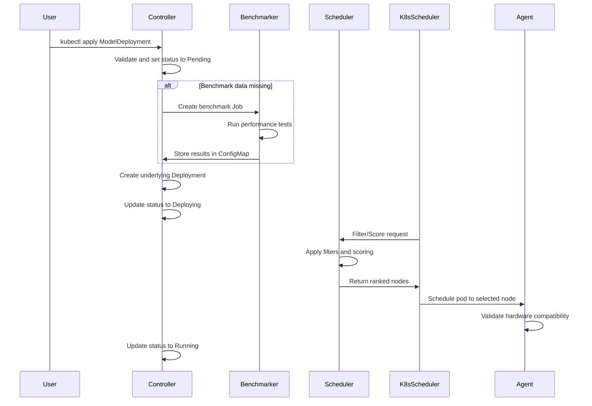

# FlexInfer Component Reference

Detailed reference for the six cooperating executables. For the quick-start overview, see [AGENTS.md](../../AGENTS.md).

| Component | Binary | Runs on | Key responsibility |
|-----------|--------|---------|--------------------|
| Node Agent | `flexinfer-agent` | Every GPU-capable node | Detect hardware & emit labels |
| Benchmarker | `flexinfer-bench` | Job pod (ephemeral) | Measure tokens/s per model-device pair |
| Controller Manager | `flexinfer-manager` | Control-plane | Reconciles `Model` (v1alpha2) and legacy v1alpha1 CRDs |
| Scheduler Extender | `flexinfer-sched` | Control-plane | Filters & scores nodes during scheduling |
| Global Proxy | `flexinfer-global-proxy` | Control-plane | Routes traffic across healthy cluster-local proxies |
| Metrics Exporter | built-in | All components | Collects Prometheus metrics for all of the above |

---

## 1. Node Agent (`flexinfer-agent`)

### What it detects

The node agent performs comprehensive hardware discovery and applies labels to nodes:

| Label | Example | Notes |
|-------|---------|-------|
| `flexinfer.ai/gpu.vendor` | `AMD` / `NVIDIA` | Populated from PCI ID detection |
| `flexinfer.ai/gpu.vram` | `24Gi` | Total VRAM per GPU in GiB |
| `flexinfer.ai/gpu.arch` | `gfx90a` / `sm_89` | GPU architecture identifier |
| `flexinfer.ai/gpu.int4` | `true` | INT4 quantization support capability |
| `flexinfer.ai/gpu.count` | `4` | Number of GPUs detected on the node |
| `flexinfer.ai/gpu.health` | `ok` / `degraded` | GPU health sentinel verdict (see below). Honored by the scheduler extender and the controller. |
| `flexinfer.ai/cpu.avx512` | `false` | CPU feature detection for fallback |

The node agent also applies node annotations that the scheduler can use as heuristic inputs:

| Annotation | Example | Notes |
|-----------|---------|-------|
| `flexinfer.ai/gpu.util` | `12.34` | Average GPU utilization (%) across all GPUs |
| `flexinfer.ai/gpu-free-memory` | `24550` | Sum of free VRAM across GPUs (MB) |
| `flexinfer.ai/kv-cache-usage` | `0.1234` | Best-effort KV-cache usage ratio from backend pod metrics |
| `flexinfer.ai/gpu.health-reason` | `card0: pcie-link-down (current_link_speed=Unknown)` | Why `gpu.health` is `degraded`; empty while `ok` |
| `flexinfer.ai/gpu.health-since` | `2026-10-22T20:03:11Z` | Time of the last `gpu.health` transition |

### GPU health sentinel

Every probe cycle starts with a sysfs-only health check of each discrete AMD
card (`/sys/class/drm/cardN/device`), before any vendor tool runs. The checks
are deliberately narrow — each signature has only ever been seen on a card
that was genuinely gone (the 2026-10 RX 7900 XTX PCIe/SMU drops):

| Reason | Evidence | Notes |
|--------|----------|-------|
| `pcie-link-down` | `current_link_speed` reads `Unknown` while `power/runtime_status` is not `suspended` | amdgpu reports `Unknown` only when the PCIe capability cannot be read. A runtime-suspended card (runpm/D3cold) legitimately reads `Unknown` and is skipped. |
| `device-io-error` | `gpu_busy_percent`, `hwmon/*/temp1_input`, `power1_average` or `power1_input` fails with `EIO`/`EREMOTEIO`/`ENXIO`/`ENODEV` | The SMU stopped answering ("Remote I/O error"). A missing attribute is not a fault. |
| `probe-timeout` | `rocm-smi`, `rocminfo` or `nvidia-smi` did not return within `--probe-timeout` (default 15 s) | On a wedged card those tools sit in uninterruptible sleep; the agent abandons the child (`exec.Cmd.WaitDelay`) instead of hanging with it. |
| `gpu-missing` | A discrete card this agent process had enumerated is no longer in sysfs | |
| `fallen-off-bus` | `nvidia-smi` printed "GPU has fallen off the bus" | |

The iGPU heuristic used for labels (drop amdgpu devices far below the largest
VRAM total) applies, so the Raphael iGPU on `cblevins-7900xtx` is never
assessed. A `pcie-link-down` or `device-io-error` verdict also makes the agent
skip the vendor tools for the rest of that cycle, so it does not add more
processes to the ones already stuck in state D.

A degraded verdict is immediate; recovery needs three consecutive clean cycles
(~90 s) so a half-answering card does not flap the scheduler. What happens
downstream:

- **Scheduler extender** `Filter` rejects the node (`GPU degraded (...)` in
  `FailedNodes`), whatever the stale `gpu-free-memory` annotation says.
- **Controller** `detectGPU` passes over degraded nodes. A Model whose only
  matching node is degraded gets `Schedulable=False` with reason
  `GPUDegraded` (message names the node and the agent's reason), its
  Deployment is parked (scaled to 0) and a `GPUDegraded` warning event is
  recorded. A Node watch keyed on the label re-reconciles every GPU Model on
  each flip, so parking and release do not wait for the periodic requeue.
- **Proxy** answers requests for a parked Model with an immediate 503 instead
  of a 25-minute cold-start timeout.
- **Metrics / alert**: `flexinfer_gpu_healthy{gpu,node,vendor}` (1/0) and
  `flexinfer_gpu_health_degraded_total{...,reason}`; the chart's
  `FlexInferGPUDegraded` (critical, `alerting.thresholds.gpuDegradedFor`,
  default 1m) pages the operator.

`--gpu-health-sentinel=false` keeps the bounded tool timeouts but publishes no
verdict (the label is left untouched, not removed). Recovery runbook:
[operations.md](operations.md#gpu-health-sentinel).

### Implementation Details

- **Hardware Detection**: Uses system calls and PCI enumeration to identify GPU hardware
- **Label Management**: Automatically applies and updates node labels based on detected capabilities
- **Error Handling**: Robust error handling for hardware detection failures
- **Caching**: Efficient caching of hardware information to reduce system load

### GPU Detection Sources (gfx1100 + Maxwell focus)

- **NVIDIA**: uses `nvidia-smi` (direct, then `chroot /host nvidia-smi` for glibc compatibility) to get architecture (`sm_52` for Maxwell), VRAM, and utilization.
- **AMD**: prefers `rocm-smi` + `rocminfo` (direct, then `chroot /host ...` as a fallback). If those utilities are unavailable, it falls back to sysfs VRAM detection and may omit `flexinfer.ai/gpu.arch`.

When multiple GPUs are present, the agent chooses the "best" representative values (highest major `gfx*` generation / highest `sm_*`, and max VRAM) so scheduling stays stable on mixed or heterogeneous nodes.

If the agent cannot list pods in `flexinfer-system`, it will still label hardware but may set telemetry annotations like `flexinfer.ai/gpu-free-memory` or `flexinfer.ai/kv-cache-usage` to `0`, which reduces scheduler placement quality.

### Config flags

| Flag | Default | Description |
|------|---------|-------------|
| `--interval` | `30s` | How often to re-probe hardware |
| `--metrics-port` | `9100` | Prometheus scrape port |
| `--label-prefix` | `flexinfer.ai/` | Customize if conflicts with other labelers (the `gpu.health` keys are fixed, shared with the scheduler/controller) |
| `--probe-timeout` | `15s` | Upper bound per vendor-tool invocation; exceeding it marks the GPU `probe-timeout` |
| `--gpu-health-sentinel` | `true` | Publish the `flexinfer.ai/gpu.health` verdict |
| `--dry-run` | `false` | Log actions without applying labels |
| `--node-name` | auto-detected | Override node name for labeling |

---

## 2. Benchmarker (`flexinfer-bench`)

### Execution Model

The benchmarker runs as a Kubernetes Job, executed once per unique model × device class combination:

1. **Model Acquisition**: Pulls the model artifact into the node's shared cache path
2. **Container Launch**: Starts the specified backend container with configured resources
3. **Performance Testing**: Executes benchmark runs with configurable parameters
4. **Result Storage**: Publishes results to a `ConfigMap` for scheduler consumption

### Implementation Features

- **Real Benchmarking**: Runs real inference requests through `flexinfer-proxy` and records tokens/sec into a ConfigMap (used by the scheduler extender)
- **Extensible Backend**: Designed to support multiple inference backends (Ollama, vLLM, etc.)
- **Resource Management**: Proper cleanup of test resources after completion
- **Error Recovery**: Robust error handling and retry logic

### Configuration Options

Available through the `ModelDeployment` CRD spec:

| CRD Field | Default | Purpose |
|-----------|---------|---------|
| `spec.benchmark.warmupIterations` | `2` | Number of warm-up runs before measurement |
| `spec.benchmark.minDuration` | `30s` | Minimum benchmark duration |
| `spec.benchmark.batchSize` | `128` | Tokens per benchmark batch |
| `spec.benchmark.iterations` | `5` | Number of measurement iterations |

---

## 3. Controller Manager (`flexinfer-manager`)

### Core Functionality

A comprehensive Kubernetes controller built with `controller-runtime` that provides:

- **CRD Reconciliation**: Complete lifecycle management of `ModelDeployment` resources
- **Status Management**: Detailed status tracking with conditions and phases
- **Event Recording**: Comprehensive event logging for debugging and monitoring
- **Finalizer Handling**: Proper cleanup of dependent resources
- **Benchmark Orchestration**: Automatic triggering of benchmarking jobs

### Status Tracking

The controller maintains detailed status information:

```go
type ModelDeploymentStatus struct {
    Phase      ModelDeploymentPhase `json:"phase,omitempty"`
    Conditions []metav1.Condition   `json:"conditions,omitempty"`
    Replicas   int32                `json:"replicas,omitempty"`
    Endpoints  []Endpoint           `json:"endpoints,omitempty"`
}
```

### Supported Phases

| Phase | Description |
|-------|-------------|
| `Pending` | Initial state, awaiting scheduling |
| `Benchmarking` | Performance measurement in progress |
| `Deploying` | Creating underlying Kubernetes resources |
| `Running` | Deployment is active and serving requests |
| `Failed` | Deployment has encountered an error |
| `Terminating` | Cleanup in progress |

### Environment variables

| Name | Default | Description |
|------|---------|-------------|
| `MODEL_CACHE_PATH` | `/models` | Shared model storage location |
| `DEFAULT_BACKEND_IMAGE` | `ollama/ollama:latest` | Legacy: Default NVIDIA backend (deprecated) |
| `DEFAULT_BACKEND_IMAGE_NVIDIA` | `ollama/ollama:latest` | NVIDIA (CUDA) inference backend |
| `DEFAULT_BACKEND_IMAGE_AMD` | `ollama/ollama:rocm` | AMD (ROCm) inference backend |
| `DEFAULT_BACKEND_IMAGE_INTEL` | `ollama/ollama:latest` | Intel inference backend |
| `BENCHMARK_IMAGE` | `flexinfer/benchmarker:latest` | Benchmarker container image |
| `METRICS_PORT` | `8080` | Controller metrics endpoint |

---

## 4. Scheduler Extender (`flexinfer-sched`)

### Scheduling Algorithm

The scheduler extender implements a sophisticated two-phase approach:

#### Filter Phase
Eliminates nodes that cannot satisfy the workload requirements:
- **GPU Requirements**: Matches requested GPU count and type
- **VRAM Requirements**: Ensures sufficient memory for the model
- **Quantization Support**: Verifies hardware supports requested quantization
- **Architecture Compatibility**: Matches model requirements with GPU architecture

#### Score Phase
Ranks suitable nodes using a weighted scoring algorithm:

```go
score = (TPS_normalized × TPS_weight) - (GPU_util × Util_weight) - (Cost × Cost_weight) - (KV_cache × Cache_weight) + (FreeVRAMRatio × VRAMFree_weight)
```

### Scoring Factors

| Factor | Weight | Description |
|--------|--------|-------------|
| Tokens/Second | 0.7 | Benchmarked performance for model-device pair |
| GPU Utilization | 0.2 | Current GPU resource usage |
| Node Cost | 0.1 | Cost per hour (from node annotations) |
| Free VRAM Ratio | 10.0 | Bonus: `free_vram / total_vram` headroom (uses agent labels + annotations) |

### Configuration

Scoring weights can be configured via Helm values:

```yaml
scheduler:
  weights:
    tps: 0.8      # Performance weight
    util: 0.1     # Utilization weight
    cost: 0.1     # Cost weight
  port: 8000      # Extender webhook port
```

### Implementation Details

- **Webhook Server**: HTTP server implementing Kubernetes scheduler extender protocol
- **Concurrent Processing**: Efficient handling of multiple scheduling requests
- **Caching**: Performance data caching for improved response times
- **Fallback Logic**: Graceful degradation when benchmark data is unavailable

---

## 5. Metrics Exporter

### Architecture

The metrics exporter is implemented as a shared Go module embedded in every binary, providing consistent observability across all components.

### Available Metrics

| Metric | Labels | Description |
|--------|--------|-------------|
| `flexinfer_tokens_per_second` | `model`, `backend`, `node` | Model performance metrics |
| `flexinfer_model_load_seconds` | `model`, `node` | Model loading time |
| `flexinfer_gpu_temperature_celsius` | `gpu`, `node` | GPU temperature monitoring |
| `flexinfer_controller_reconciles_total` | `result` | Controller reconciliation count |
| `flexinfer_scheduler_requests_total` | `phase`, `result` | Scheduler extender request count |
| `flexinfer_benchmark_duration_seconds` | `model`, `device_class` | Benchmark execution time |

### Prometheus Configuration

```yaml
scrape_configs:
- job_name: 'flexinfer-agent'
  kubernetes_sd_configs:
  - role: node
  relabel_configs:
  - source_labels: [__meta_kubernetes_node_label_flexinfer_ai_enabled]
    regex: "true"
    action: keep

- job_name: 'flexinfer-controller'
  static_configs:
  - targets: ['flexinfer-controller:8080']

- job_name: 'flexinfer-scheduler'
  static_configs:
  - targets: ['flexinfer-scheduler:8000']
```

---

## Communication Flow



---

## Advanced Features

### Status Conditions

The controller maintains detailed condition information:

- `Available`: Deployment is ready to serve traffic
- `Progressing`: Deployment is being updated
- `ReplicaFailure`: Unable to create desired replicas
- `BenchmarkComplete`: Performance measurement finished
- `NodeSelected`: Scheduling completed successfully

### Event Recording

Comprehensive event logging covers:
- Deployment lifecycle events
- Benchmark execution status
- Scheduling decisions and outcomes
- Error conditions and recovery actions

### Resource Management

- **Finalizers**: Proper cleanup ordering with `flexinfer.ai/finalizer`
- **Owner References**: Garbage collection of dependent resources
- **Resource Quotas**: Integration with Kubernetes resource management

---

## Troubleshooting

### Common Issues

1. **Node labels not appearing**: Check agent logs and RBAC permissions
2. **Benchmarks not triggering**: Verify benchmark job creation and ConfigMap access
3. **Scheduling failures**: Check scheduler extender logs and webhook connectivity
4. **Status not updating**: Verify controller reconciliation loops and event recording
5. **Helm upgrades stuck / DaemonSet not ready**: In homelabs, a NotReady/unreachable node can leave old pods stuck `Terminating`, which can block rollouts. Force-delete the stuck pods in `flexinfer-system` to unblock upgrades.

### Debug Commands

```bash
# Check node labels
kubectl get nodes --show-labels | grep flexinfer

# View controller logs
kubectl logs -n flexinfer-system deployment/flexinfer-controller

# Check benchmark results
kubectl get configmaps -n flexinfer-system -l app=flexinfer-benchmarks

# View scheduler decisions
kubectl logs -n kube-system deployment/flexinfer-scheduler

# If rollouts are stuck, look for pods stuck Terminating on a dead node
kubectl -n flexinfer-system get pods -o wide | rg Terminating
# Force-delete a stuck pod to unblock the rollout
kubectl -n flexinfer-system delete pod <pod-name> --force --grace-period=0
```

---

## Future Roadmap

### Phase 2 (Production Ready)
- KV-Cache tiering: GPU HBM to host DDR memory management
- Harbor model OCI plugin: Direct model registry integration
- Advanced monitoring: Detailed performance analytics
- Multi-tenancy: Namespace isolation and resource quotas

### Phase 3 (Enterprise Features)
- Autoscaling: HPA integration with custom metrics
- Cost optimization: Advanced cost-aware scheduling
- Security: Enhanced RBAC and admission controllers
- Compliance: Audit logging and policy enforcement

---

## Feedback & Support

- **GitHub Issues**: [FlexInfer Issues](https://github.com/flexinfer/flexinfer/issues)
- **Discussions**: [GitHub Discussions](https://github.com/flexinfer/flexinfer/discussions)
- **Discord**: #flexinfer channel on Llama.cpp Discord
