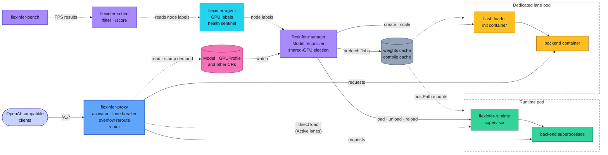
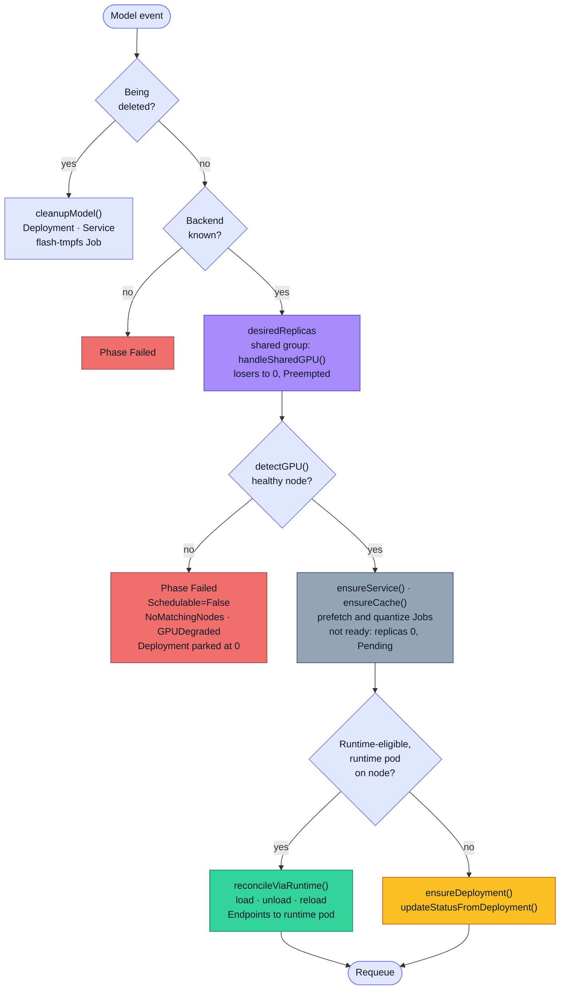
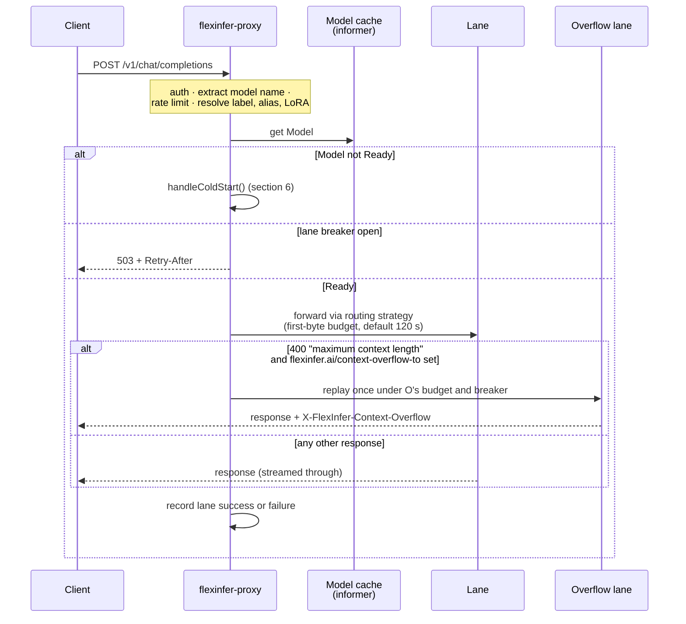
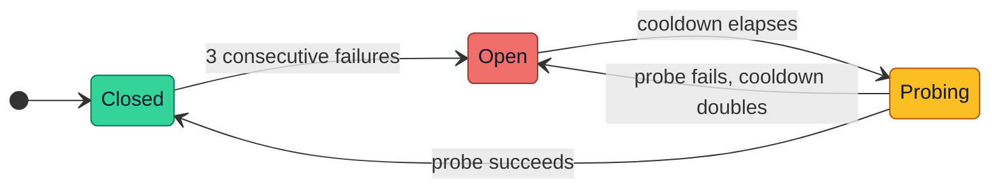
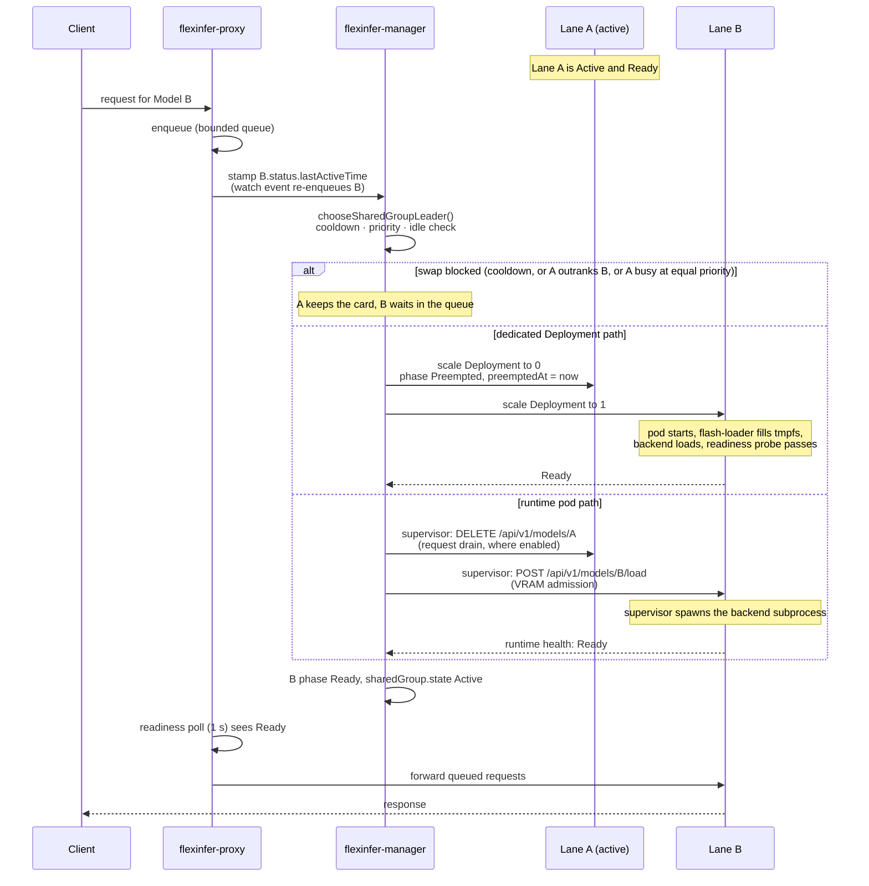
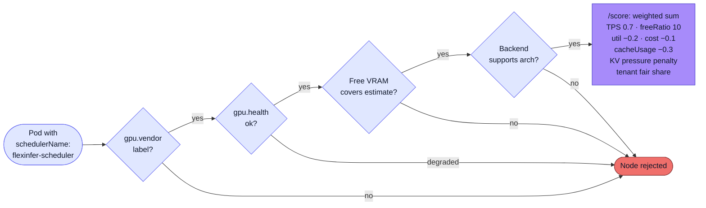
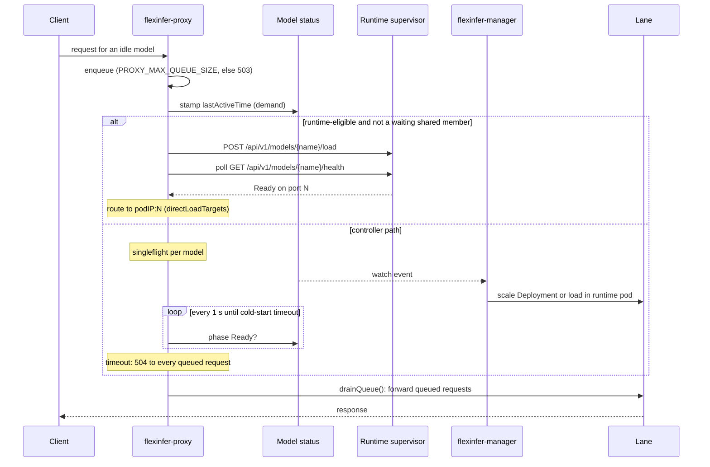

# Architecture

FlexInfer is a set of cooperating components:

- `flexinfer-manager`: Kubernetes controller manager. Reconciles CRDs into Services, Deployments, cache Jobs and runtime-pod loads, and runs the shared-GPU election.
- `flexinfer-proxy`: OpenAI-compatible request router. Scale-to-zero activator, per-lane breaker, context-overflow reroute and routing strategies.
- `flexinfer-runtime`: supervisor inside the per-node runtime pod (DaemonSet). Starts, stops and swaps backend subprocesses, with VRAM admission and request drain.
- `flexinfer-agent`: node-level GPU discovery and labeling, plus the GPU health sentinel.
- `flexinfer-sched`: scheduler extender (`/filter`, `/score`) for pods scheduled by the `flexinfer-scheduler` kube-scheduler profile.
- `flexinfer-bench`: benchmark runner for tokens/sec measurement and the benchmark gauntlet.
- `flexinfer-flash-loader`: init container that preloads weights into node tmpfs (PVC or hostPath to `/dev/shm`) before a dedicated lane's backend starts.

`cmd/` also holds the `flexinfer` CLI, `flexinfer-global-proxy` (multi-cluster), `agent-loop`, `voice-loop` and `spec-decode-bench`.

## Diagram key

Flowcharts on this page use one colour per component role. The same palette is used in the README and the GPU-sharing docs.

| Colour | Role |
|---|---|
| Blue | `flexinfer-proxy` (request path) |
| Violet | Controller and scheduler extender (control plane) |
| Cyan | `flexinfer-agent` |
| Green | Runtime pod path |
| Amber | Dedicated Deployment path |
| Pink | Custom resources |
| Slate | Caches and storage |
| Coral | Failure or rejection |

## CRDs

All kinds are in the API group `ai.flexinfer`. Reference: [model-crds.md](../agents/model-crds.md).

| API Version | Kind | Purpose |
|---|---|---|
| v1alpha2 | `Model` | Single-resource lane lifecycle (recommended) |
| v1alpha2 | `GPUProfile` | Per GPU architecture: VRAM, features, per-backend images and env, runtime-pod bundled backends, digest-bound backend certificates |
| v1alpha2 | `LoRAAdapter` | Hot-swap LoRA adapters for vLLM |
| v1alpha2 | `ModelCatalog` | OCI model registry (Harbor, GHCR, ECR) |
| v1alpha2 | `ModelExperiment` | Isolated candidate run through the benchmark gauntlet |
| v1alpha2 | `ModelBackfill` | Bounded CPU-side Jobs against an already-warm model |
| v1alpha2 | `GPULease` | Parks a shared group's serving lanes while a training or quantization Job holds the card |
| v1alpha2 | `GamingSession`, `WorkflowProfile` | Gaming-mode sessions and workflow profiles |
| v1alpha2 | `Cluster`, `FederatedModel`, `GlobalProxy` | Multi-cluster federation |
| v1alpha1 | `ModelCache` | Standalone artifact staging plus quantization, abliteration, fine-tune and publish pipelines |
| v1alpha1 | `ModelDeployment` | Legacy per-deployment resource (deprecated) |
| v1alpha1 | `GPUGroup` | Explicit GPU sharing policies + anti-thrashing (deprecated) |

## Backend plugins

| Backend | Port | GPU | Notes |
|---|---|---|---|
| `vllm` | 8000 | NVIDIA, AMD | OpenAI-compatible, high throughput |
| `llamacpp` | 8080 | NVIDIA, AMD, CPU | GGUF models, CPU/GPU hybrid |
| `diffusers` | 8000 | NVIDIA, AMD | Image and video generation (SD, FLUX, Wan, Qwen-Image) |
| `snac` | 8000 | NVIDIA, AMD | SNAC waveform decode for TTS; runtime-pod subprocess only, no standalone image |
| `ollama` | 11434 | NVIDIA, AMD | Downloads models on demand |
| `vllm-omni` | 8000 | NVIDIA, AMD | Diffusion and multimodal models with the OpenAI API |
| `comfyui` | 8188 | NVIDIA, AMD | Workflow-based image generation |
| `mlc-llm` | 8000 | NVIDIA, AMD | Kept in the registry; no current lane uses it |

## Code layout

High-signal directories:

- `api/`: Go types for CRDs (source of schema)
- `controllers/`: reconciliation logic (`model_controller.go`, `model_shared_gpu.go`, `model_runtime.go`, `runtime_controller.go`, `modelcache_*`)
- `backend/`: backend plugin registry (images, args, probes per backend)
- `scheduler/`: scheduler extender logic (filter + score)
- `internal/proxy/`: proxy routing, activation, lane breaker, context-overflow reroute, connection tracking
- `internal/runtime/`: runtime supervisor (subprocess manager, ingress, VRAM admission)
- `pkg/runtime/`: runtime load payload and runtime eligibility (`payload.go`), shared by controller and proxy
- `agents/`: node agent (`agents/agent/`, including `health.go`) and benchmarker
- `pkg/registry/`: OCI registry adapters (Harbor, GHCR, ECR)
- `cmd/`: main packages for binaries

---

## 1. System overview



The agent labels GPU nodes with vendor, architecture, VRAM and count, and its health sentinel sets `flexinfer.ai/gpu.health`. The controller reconciles `Model` resources: it elects the active members of each shared group, stages weights, and then serves the lane one of two ways. If the lane is runtime-eligible and the node runs a runtime pod, the controller loads it into that pod through the supervisor API and points a selectorless Service at the pod. Otherwise it creates a dedicated Deployment. The proxy routes requests, holds requests for idle lanes while they activate, and signals demand by stamping `status.lastActiveTime`. The scheduler extender filters and scores nodes for pods that use the `flexinfer-scheduler` profile.

---

## 2. Controller reconciliation loop

The v1alpha2 `ModelReconciler` (`controllers/model_controller.go`) runs this flow on every `Model` event:



Runtime eligibility is `pkg/runtime.DirectRuntimeLoadEligibility`: the Model does not set `config.dedicatedDeployment` or `gpu.vendor: cpu`, its backend is in the GPUProfile's `runtime.bundledBackends`, and a `pvc://` source is staged through a `Local` cache. When a runtime pod exists on the node but is still starting, the controller waits for it instead of creating a Deployment, which would claim the GPU first.

### Key patterns

**Selective field merge**: The controller compares only the ~15 fields it manages (`deploymentManagedFieldChanges()`), ignoring K8s-defaulted fields like `revisionHistoryLimit`, `progressDeadlineSeconds`, and container `terminationMessagePath`. This prevents infinite update loops caused by API server defaults.

**Cache-gating**: `desiredReplicas` is forced to 0 until `ensureCache()` reports ready. The Deployment is created with `replicas=0`, and the phase stays `Pending` until cache prefetch/quantization jobs complete. An active shared-group member that already has a pod keeps it through a cache refresh.

**GPU health parking**: `detectGPU()` passes over nodes labelled `flexinfer.ai/gpu.health=degraded`. A Model whose only matching node is degraded gets `Schedulable=False` with reason `GPUDegraded`, and its Deployment is parked at 0. A Node watch re-reconciles GPU Models when the label flips.

**Tolerations injection**: Two injection points:
1. Deployment pods get `dedicated=gpu:NoSchedule` when `gpuCount > 0`
2. Quantization jobs get the same toleration when `spec.quantize.useGPU == true`

**Nil-vs-empty normalization**: Pointer types like `SecurityContext` and `Affinity` use `podObjectEqual[T]()` to treat `nil` and `&{}` as equivalent, avoiding spurious updates.

---

## 3. Proxy request routing

The proxy (`internal/proxy/`) handles model extraction, gating, routing strategy selection, and reverse-proxying to the lane.



Before the readiness check the proxy also refuses requests the Model does not serve (`flexinfer.ai/serve-paths`, 404) and, when the Model opts in with `flexinfer.ai/admission`, prompts over the context budget (413). A lane with no first response byte inside its budget fails the request with 504 and counts against the breaker.

### Model extraction cascade

The proxy tries four sources in order (`resolver.go:extractModelNameAndBody()`):

1. `X-Model-ID` header
2. `/model/<name>/...` path prefix (stripped before forwarding)
3. JSON body `{ "model": "<name>" }` (POST + `application/json`)
4. Multipart form `"model"` field (POST + `multipart/form-data`)

For multipart requests (e.g., `/v1/images/edits`), the body is forwarded intact — no JSON model rewriting occurs. The `bodyBytes` return is `nil`, which signals the routing layer to skip the `rewriteModelInBody()` call.

### Routing strategies

| Strategy | Key source | Mechanism |
|---|---|---|
| default | — | K8s Service DNS (ClusterIP) |
| `session-affinity` | `X-Session-ID` > `X-Conversation-ID` > body `session_id` > SHA256(first 5 messages) | CRC32 hash ring (150 vnodes/pod) |
| `prefix` | `X-Flexinfer-Cache-Key` > body `cache_key` > canonical hash | CRC32 hash ring |
| `least-loaded` | active connection count | Select pod with fewest connections |

The strategy comes from the Model annotation `flexinfer.ai/routing`.

### Lane breaker

Each lane (a base model and its LoRA adapters) has a breaker in `internal/proxy/lane_breaker.go`:



A failure is a request with no first byte inside the budget or an upstream error; any success resets the count. The first cooldown is 1 minute and doubles on each failed probe, up to 10 minutes. While the breaker is open, requests get 503 with `Retry-After`. The probe is a one-token chat completion, an embeddings call for embeddings-only lanes, or `GET /health` for lanes that serve neither (images, audio, rerank). The budget comes from `flexinfer.ai/lane-first-byte-budget` on the Model, else `FLEXINFER_PROXY_LANE_FIRST_BYTE_BUDGET` (120 s). Threshold and cooldowns are set by `FLEXINFER_PROXY_LANE_BREAKER_THRESHOLD`, `_COOLDOWN` and `_MAX_COOLDOWN`. A client that cancels after the first byte does not count as a failure.

### Background goroutines

- **`watchEndpoints()`** (every 10s): Syncs ready pod IPs from K8s Endpoints into per-model hash rings. Excludes pods on spot-terminating nodes.
- **`cleanupStaleQueues()`** (every 30s): Removes empty queues older than `2 * queueTimeout`.

---

## 4. GPU sharing swap

FlexInfer supports two GPU sharing mechanisms. Both use priority-based swapping with anti-thrashing.

### v1alpha2: `spec.gpu.shared` (model_shared_gpu.go)

Models sharing the same `gpu.shared` group name compete for a single GPU. The controller runs `handleSharedGPU()` → `chooseSharedGroupLeader()` on every reconcile of a member. On GPUProfiles with `features.multiModel`, `chooseSharedGroupLeaders()` also admits other members that want to run, by priority, while their summed `gpu.vramEstimateMB` fits the profile's VRAM. The decision tree is drawn in [gpu-sharing.md](../user/gpu-sharing.md#leader-election-algorithm-v1alpha2).

### v1alpha1: `GPUGroup` CRD (gpugroup_controller.go, deprecated)

The `GPUGroup` resource manages explicit groups with configurable anti-thrashing policies. The proxy signals its demand through queue annotations (`flexinfer.ai/queue.<model>`) instead of `lastActiveTime`.

The v1alpha2 swap runs the same way up to the election, then differs by serving path:



On the runtime path both lanes live in the same runtime pod, so the controller's calls go to that pod's supervisor. In single-slot mode a load also unloads the incumbent first; in multi-model mode the supervisor admits the new backend only when free VRAM covers it.

### Anti-thrashing constants

| Mechanism | Parameter | v1alpha2 default | v1alpha1 default |
|---|---|---|---|
| Demand window | How recent demand must be to count | 2 min (`sharedDemandWindow`) | 10s (`HysteresisWindowSeconds`) |
| Queue threshold | Min queue depth before swap | 1 (any demand) | 3 (`RequestQueueThreshold`) |
| Swap cooldown | Post-swap protection | 5 min (`sharedSwapCooldown`, `spec.gpu.swapCooldown`) | 30s (`MinimumRunDurationSeconds`) |
| Preemption cooldown | After being preempted | — | 60s (`CooldownAfterPreemptionSeconds`) |
| Priority gate | Who may preempt | Higher priority preempts at once; equal priority only when the Ready member is idle | Implicit in sort order |

### Observed swap latency (gfx1100, dedicated Deployment path, typical)

| Phase | Duration |
|---|---|
| Demand window + controller detect | ~5–10s |
| Pod termination (graceful) | ~4s |
| Flash-loader (if enabled) | ~6s |
| Model load (backend startup) | ~22s |
| First inference | ~15s |
| **Total (cold, no flash)** | ~45–60s |
| **Total (with flash-loader)** | ~35–50s |

In-pod swaps on the runtime path skip pod termination and scheduling. On the Radeon VII, in-pod llama.cpp swaps measured p50 3.5–5.6 s and p95 9.2 s over 30 days to 2026-10-27 ([serving-gaps review §2](../../.loom/10-research-serving-gaps-switching-caching-2026-10-27.md)).

---

## 5. Scheduler filter + score

The scheduler extender (`scheduler/scheduler.go`) provides `/filter` and `/score` endpoints. The chart wires it into a kube-scheduler profile named `flexinfer-scheduler` (`charts/flexinfer/templates/scheduler-configmap.yaml`); it sees only pods that set `schedulerName: flexinfer-scheduler`.



### Filter checks

| # | Check | Source | Failure reason |
|---|---|---|---|
| 1 | GPU vendor label exists | Node label `flexinfer.ai/gpu.vendor` | No vendor label |
| 2 | GPU healthy | Node label `flexinfer.ai/gpu.health` (agent health sentinel) | GPU degraded, with the agent's reason |
| 3 | Free VRAM sufficient | Node annotation `flexinfer.ai/gpu-free-memory` vs pod annotation `flexinfer.ai/gpu.vram-estimate-mb` | Insufficient VRAM |
| 4 | Backend arch supported | `backend.LookupGPUArchSupport(backend, arch)` | Unsupported arch |

Checks 3 and 4 are conditional — they run only when the relevant annotations/labels are present.

### Score formula

```
score = tps × tpsWeight
      − util × utilWeight
      − cost × costWeight
      − cacheUsage × cacheWeight
      + freeRatio × vramFreeWeight
      − kvPressurePenalty
      + tenantAdjustment
```

### Score weights (configurable via env vars)

| Weight | Env var | Default | Effect |
|---|---|---|---|
| `tpsWeight` | `SCHED_TPS_WEIGHT` | **0.7** | Prefer faster nodes |
| `utilWeight` | `SCHED_UTIL_WEIGHT` | **0.2** | Avoid busy nodes |
| `costWeight` | `SCHED_COST_WEIGHT` | **0.1** | Prefer cheaper nodes |
| `cacheWeight` | `SCHED_CACHE_WEIGHT` | **0.3** | Avoid KV-cache-heavy nodes |
| `vramFreeWeight` | `SCHED_VRAM_FREE_WEIGHT` | **10.0** | Strongly prefer VRAM headroom |
| `tenantFairShareWeight` | `SCHED_TENANT_FAIRSHARE_WEIGHT` | **5.0** | Fair-share adjustment (optional) |

### KV-cache pressure penalty

When `cacheUsage > 0.85`, the penalty ramps linearly:

```
kvPressurePenalty = (cacheUsage − 0.85) × 20.0
```

This makes nodes with high KV-cache pressure increasingly unattractive.

### TPS lookup

Benchmark results are resolved in order:
1. Global ConfigMap keyed by `SHA256(backend|model|deviceClass)`
2. Per-deployment ConfigMap `md-benchmark-results` (key `tokensPerSecond`)
3. Falls back to `0.0`

---

## 6. Scale-to-zero activation

When a request arrives for a model that is not Ready, the proxy queues the request and activates the lane. It first tries a direct load on the node's runtime pod, then falls back to the controller.



### Activation details

- **Direct runtime fast path** (`PROXY_DIRECT_RUNTIME_ENABLED`, default on): the proxy loads a runtime-eligible Model on a ready runtime pod itself. A shared-group member uses it only once the election has made it `Active`; otherwise the proxy waits for the controller.
- **Demand signal**: for v1alpha2 Models the proxy only stamps `status.lastActiveTime` (status merge patch). The controller does the scale-up. The v1alpha1 `ModelDeployment` fallback sets `spec.replicas = 1` directly.
- **Singleflight**: `sync/singleflight.Group` deduplicates concurrent scale-up triggers for the same model.
- **Cold start timeout**: `max(PROXY_QUEUE_TIMEOUT, spec.serverless.coldStartTimeout)`, default 60s. Expiry returns 504; a full queue returns 503.
- **Backoff** (optional, `PROXY_BACKOFF_ENABLED`): Retries with exponential backoff and jitter on failed activation.
- **Connection tracking**: `trackAndServe()` increments an atomic counter + Prometheus gauge `active_connections{model}`. The proxy also updates `LastActiveTime` asynchronously (throttled to once per minute).
- **Idle scale-down**: The controller checks `time.Since(LastActiveTime) > idleTimeout` and sets `replicas = minReplicas` when the model is idle. Default idle timeout is 300s (5 min).

### Configuration

| Env var | Default | Purpose |
|---|---|---|
| `PROXY_MAX_QUEUE_SIZE` | 100 | Max queued requests per model |
| `PROXY_QUEUE_TIMEOUT` | 60s | Max wait time in queue |
| `PROXY_COLD_START_TIMEOUT` | 60s | Max wait for model readiness |
| `PROXY_DIRECT_RUNTIME_ENABLED` | true | Try a direct runtime-pod load before the controller path |
| `PROXY_BACKOFF_ENABLED` | false | Enable retry with exponential backoff |
| `PROXY_BACKOFF_MAX_RETRIES` | 3 | Max retry attempts |
