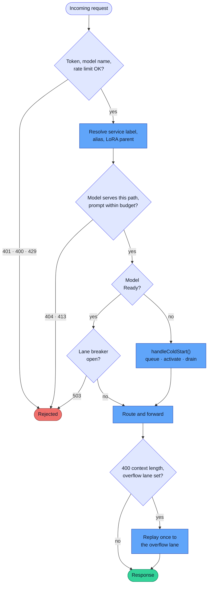

# Proxy API

Binary: `flexinfer-proxy` (`services/flexinfer/cmd/flexinfer-proxy`)

The proxy is intentionally small: it doesn’t define a new inference protocol. Instead, it:

- routes requests to backend services
- uses the `"model"` selection semantics common to OpenAI-compatible APIs
- queues during cold starts

Machine-readable OpenAPI spec:

- `services/flexinfer/specs/openapi/flexinfer-proxy.openapi.yaml`

## HTTP endpoints

### `GET /healthz`

Returns `200 ok` when the process is up.

### `GET /metrics`

Prometheus metrics for proxy queueing + activation behavior.

### `GET /v1/models`

OpenAI-compatible model listing. It aggregates:

- v1alpha1 `ModelDeployment` resources
- v1alpha2 `Model` resources

Response shape:

```json
{ "object": "list", "data": [ { "id": "llama3-8b", "object": "model", "created": 0, "owned_by": "flexinfer", "metadata": {} } ] }
```

### `/*` (reverse proxy)

All other paths are forwarded to the selected model backend (subject to scale-to-zero/activation).

## Model selection

The proxy extracts model name from (first match wins):

1. `X-Model-ID` header
2. `/model/<name>/...` path prefix (stripped before forwarding)
3. OpenAI JSON body `{ "model": "<name>" }` (POST + `application/json`)
4. Multipart form `"model"` field (POST + `multipart/form-data`, e.g., `/v1/images/edits`)

For multipart requests, the payload is forwarded intact to the backend — no JSON model rewriting occurs.

## Request flow



Forwarding rewrites `"model"` in a JSON body to the backend's model name; a multipart body is forwarded intact. Status codes the proxy itself returns:

| Gate | Status |
|---|---|
| Bearer token invalid (auth enabled) | 401 |
| No model name in header, path, JSON or multipart | 400 |
| Rate limit exceeded | 429 |
| Request validation failed (when enabled) | 400 |
| No such Model, or the Model does not serve this path (`flexinfer.ai/serve-paths`) | 404 |
| Prompt over the context budget (`flexinfer.ai/admission` opt-in) | 413 |
| Lane breaker open | 503 + `Retry-After` |
| Not Ready and parked: `spec.litellm.enabled: false` | 404 |
| Not Ready and parked behind a higher-priority warm primary | 503 |
| Cold start: queue full | 503 |
| QoS: no seat for a `background`/`batch` request within the queue bound (enforcing lanes only) | 503 `queue_full` + `Retry-After` |
| Cold start: readiness timeout | 504 |
| No first byte from the lane within its budget (counts against the breaker) | 504 |

Code: `internal/proxy/proxy.go` (`handleRequest`), `lane_breaker.go`, `context_overflow.go`, `queue.go`, `pkg/validation/errors.go`.

## Scale-to-zero contract

If a model has zero replicas (idle), the proxy may:

- enqueue the request (bounded by `PROXY_MAX_QUEUE_SIZE`)
- activate the model
- wait for readiness (bounded by `PROXY_QUEUE_TIMEOUT` / `PROXY_COLD_START_TIMEOUT`)

Configuration details live in `docs/CONFIGURATION.md`.

## Caller QoS classes

Every inference request resolves to one QoS class (`internal/proxy/qos.go`). First match wins:

1. `X-FlexInfer-QoS: interactive|background|batch` request header (case-insensitive; an unknown
   value is ignored).
2. The caller-identity map in ConfigMap `flexinfer-proxy-qos` (chart values `proxy.qos`): first
   the sha256 of the bearer key (`apiKeys`, stored as `sha256:<hex>`), then the caller name
   (`callers`). The caller name is the `X-FlexInfer-Caller` header, else the User-Agent's first
   product token (`loom-mills/1.4` → `loom-mills`), lower-cased.
3. A LiteLLM alias suffix on the requested model: `workhorse-background` routes to `workhorse` as
   `background`, `<name>-batch` as `batch`. The suffix is honoured only when the full name is not
   itself a Model, service label, alias or LoRA adapter.
4. `interactive`.

| Class | vLLM priority | Intended callers |
|---|---|---|
| `interactive` | 0 | people waiting on an answer: jobsearch, psyche, the HUD, fi-fhir |
| `background` | 10 | agent research, shadow judging, evaluation sweeps (Mills) |
| `batch` | 20 | asynchronous jobs |

The proxy strips `X-FlexInfer-QoS` and `X-FlexInfer-Caller` before forwarding. The class is
independent of the proxy-internal `X-FlexInfer-Internal-Workload-Class` header, which only decides
whether a request may create cold-start demand: a `background` request still activates a cold
lane.

The class labels the `request start` and `request usage` log lines (`qos_class`, `qos_source`,
`caller`) and three metrics: `flexinfer_proxy_qos_decisions_total{class,lane,outcome}`,
`flexinfer_proxy_qos_ttft_seconds{class,lane}` (streaming completions, time to the first upstream
byte) and `flexinfer_proxy_qos_request_duration_seconds{class,lane}`. A lane that does not enforce
classes serves every request as before and counts it as `outcome="unenforced"`.

### Enforcement

A lane enforces classes only when it opts in (`docs/specs/labels-and-annotations.md`,
`flexinfer.ai/qos`): `spec.config.schedulingPolicy: priority`, or the annotation
`flexinfer.ai/qos: proxy` for the proxy gate without vLLM priority. On such a lane the proxy keeps
an in-flight count against `spec.config.maxNumSeqs` (the seats):

- `interactive` is always forwarded at once, even past the seat count (vLLM queues it).
- `background` and `batch` are forwarded while fewer than `seats - reserve` requests are in
  flight, where the reserve (`flexinfer.ai/qos-interactive-reserve`, default 1 on a lane with two
  or more seats) stays free for interactive turns. Otherwise they wait in a per-lane queue,
  `background` ahead of `batch`, FIFO within a class, for up to `FLEXINFER_PROXY_QOS_QUEUE_WAIT`
  (chart `proxy.qos.queueWait`, default 60 s) and at most `proxy.qos.queueDepth` (default 32)
  deep.
- A request the queue cannot take, or that waits out the bound, gets **503** with code
  `queue_full`, `Retry-After` (the lane's recent request duration times the requests ahead per
  background seat) and `X-FlexInfer-Queue-Position`.
- The cold-start queue drains in the same class order.

The reserve exists because vLLM 0.32 does not preempt a running sequence to free a seat: once
`max_num_seqs` sequences run, its scheduler stops admitting, and `--scheduling-policy priority`
only orders the waiting queue and chooses which sequence to preempt when KV blocks run out. Without
the reserve, two background generations would hold both seats of a two-seat lane and an
interactive turn would wait for one to finish.

Outcomes in `flexinfer_proxy_qos_decisions_total`: `admitted` (took a seat at once), `queued`
(after waiting), `rejected` (503 `queue_full`), `canceled` (the caller left while waiting),
`unenforced`. The gate counts one proxy replica's requests and assumes one lane replica.

The proxy re-reads the mounted map every 30 s, so a values change needs no pod roll.
