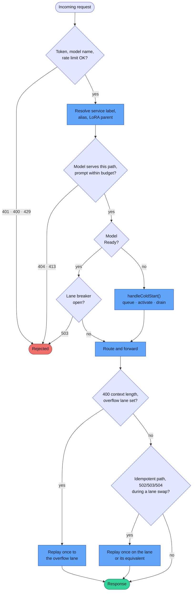

# Proxy API

Binary: `flexinfer-proxy` (`services/flexinfer/cmd/flexinfer-proxy`)

The proxy is intentionally small: it doesn’t define a new inference protocol. Instead, it:

- routes requests to backend services
- uses the `"model"` selection semantics common to OpenAI-compatible APIs
- queues during cold starts

Machine-readable OpenAPI spec:

- `services/flexinfer/specs/openapi/flexinfer-proxy.openapi.yaml`

## HTTP endpoints

### `GET /healthz`

Returns `200 ok` when the process is up.

### `GET /metrics`

Prometheus metrics for proxy queueing + activation behavior.

### `GET /v1/models`

OpenAI-compatible model listing. It aggregates:

- v1alpha1 `ModelDeployment` resources
- v1alpha2 `Model` resources

Response shape:

```json
{ "object": "list", "data": [ { "id": "llama3-8b", "object": "model", "created": 0, "owned_by": "flexinfer", "metadata": {} } ] }
```

### `/*` (reverse proxy)

All other paths are forwarded to the selected model backend (subject to scale-to-zero/activation).

## Model selection

The proxy extracts model name from (first match wins):

1. `X-Model-ID` header
2. `/model/<name>/...` path prefix (stripped before forwarding)
3. OpenAI JSON body `{ "model": "<name>" }` (POST + `application/json`)
4. Multipart form `"model"` field (POST + `multipart/form-data`, e.g., `/v1/images/edits`)

For multipart requests, the payload is forwarded intact to the backend — no JSON model rewriting occurs.

## Request flow



Forwarding rewrites `"model"` in a JSON body to the backend's model name; a multipart body is forwarded intact. Status codes the proxy itself returns:

| Gate | Status |
|---|---|
| Bearer token invalid (auth enabled) | 401 |
| No model name in header, path, JSON or multipart | 400 |
| Rate limit exceeded | 429 |
| Request validation failed (when enabled) | 400 |
| No such Model, or the Model does not serve this path (`flexinfer.ai/serve-paths`) | 404 |
| Prompt over the context budget (`flexinfer.ai/admission` opt-in) | 413 |
| Lane breaker open | 503 + `Retry-After` |
| Not Ready and parked: `spec.litellm.enabled: false` | 404 |
| Not Ready and parked behind a higher-priority warm primary | 503 |
| Cold start: queue full | 503 |
| Cold start: readiness timeout | 504 |
| No first byte from the lane within its budget (counts against the breaker) | 504 |

Code: `internal/proxy/proxy.go` (`handleRequest`), `lane_breaker.go`, `context_overflow.go`, `swap_replay.go`, `queue.go`, `pkg/validation/errors.go`.

## Swap-safe replay

A multi-model runtime drains a lane before it unloads or reloads it: the lane's ingress answers new requests with `503 model is draining` (`Retry-After: 1`) while accepted ones finish, then the backend stops and its port closes. For idempotent, non-streaming requests the proxy holds back the failure and replays the request **once** when the failure coincides with a swap of the lane.

| | |
|---|---|
| Paths | `POST /v1/embeddings`, `/v1/rerank`, `/rerank`, `/v1/score`, and `/v1/audio/transcriptions` without `stream=true`. Never chat or completions, never a streamed body, never a LoRA adapter. |
| Held back | 502, 503 and 504 (bodies up to 64 KiB). Every other status passes through as it arrives. |
| Swap signals | The lane is parked in its shared group (`status.sharedGroup.state` not `Active`); the body is the runtime's drain answer; the lane is not `Ready`; or it was preempted, or became `Ready`, in the last 60 s. Without a signal the failure is the lane's own and reaches the caller unchanged. |
| Where | A parked lane is replayed on its `flexinfer.ai/unavailable-reroute-to` equivalent at once, if that Model is `Ready`, serves the path and its breaker is closed; a parked lane without one fails fast with the original response. A draining or reloading lane is replayed on itself once it is `Ready` and `Active` again and `GET /health` on its target answers below 500, polled every 250 ms; when the wait runs out the equivalent is used if it can serve. The equivalent is never cold-started. |
| Bound | The wait ends at the earliest of `FLEXINFER_PROXY_SWAP_REPLAY_WAIT` (default `30s`), the lane's first-byte budget measured from the request start, and the client's own deadline or disconnect. Then the original failure is returned. |
| Caller sees | The replay's response, with `X-FlexInfer-Replayed: <lane>-><served lane>` (for example `gte-qwen2-1p5b-radeonvii->gte-qwen2-1p5b-cpu-5930k`). The held-back response's headers are discarded. A replay that fails is returned as is; it is never replayed again. |
| Metric | `flexinfer_proxy_replays_total{lane,outcome}`, outcome `same_lane`, `reroute`, `failed` or `no_ready_lane`. |
| Off switch | `FLEXINFER_PROXY_SWAP_REPLAY=false` on the proxy. |

This sits after the dial-class retry in `routing_retry.go`, which re-dials a refused or reset connection once through the Service before any status exists.

## Scale-to-zero contract

If a model has zero replicas (idle), the proxy may:

- enqueue the request (bounded by `PROXY_MAX_QUEUE_SIZE`)
- activate the model
- wait for readiness (bounded by `PROXY_QUEUE_TIMEOUT` / `PROXY_COLD_START_TIMEOUT`)

Configuration details live in `docs/CONFIGURATION.md`.
