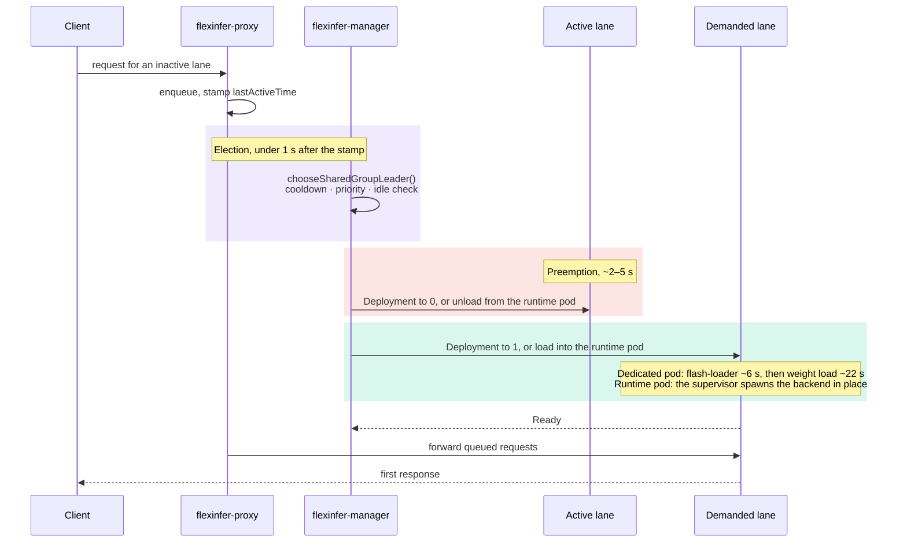
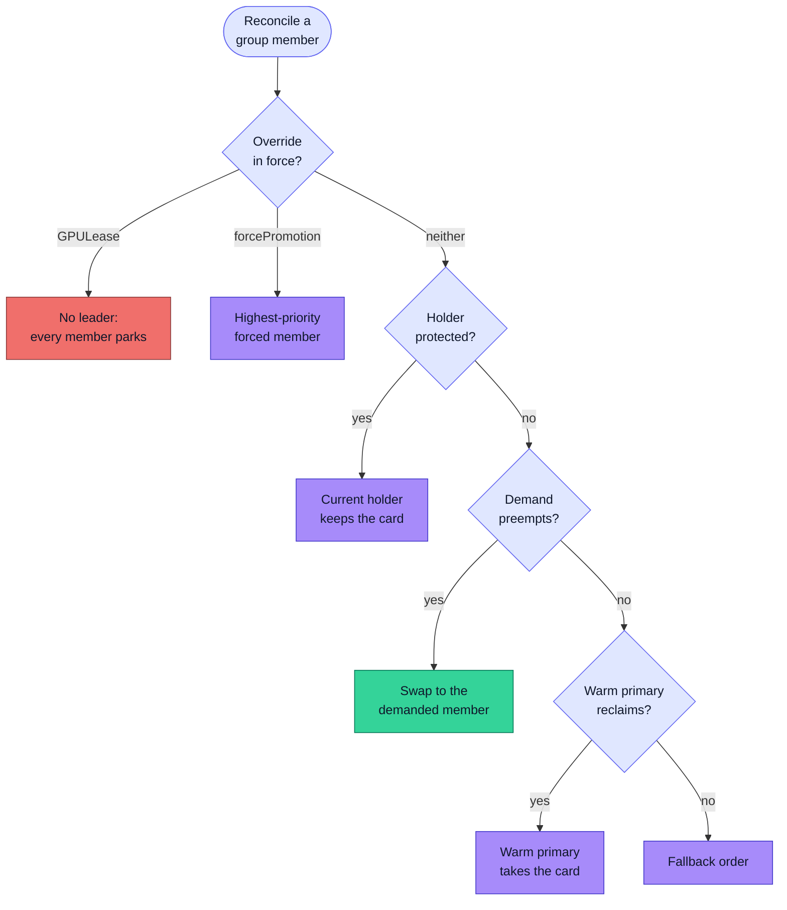

# GPU sharing

FlexInfer supports two GPU-sharing models:

- **v1alpha2**: `Model.spec.gpu.shared` (simple, homelab-friendly)
- **v1alpha1**: `GPUGroup` (explicit policies + anti-thrashing)

## v1alpha2: `spec.gpu.shared`

Models with the same `shared` value compete for the same GPU. Higher priority wins.

```yaml
apiVersion: ai.flexinfer/v1alpha2
kind: Model
metadata:
  name: qwen3-8b
spec:
  backend: mlc-llm
  source: HF://mlc-ai/Qwen3-8B-q4f16_1-MLC
  gpu:
    shared: homelab-gpu
    priority: 100
```

## v1alpha1: `GPUGroup`

`GPUGroup` enables:

- one-active-at-a-time swapping
- anti-thrashing controls
- proxy-driven demand signaling based on real queued requests

See:

- `services/flexinfer/examples/gpugroup-multi-model.yaml`
- `docs/DEPLOYMENT_RUNBOOK.md` (operational notes)

## Training on a shared card (GPU lease)

Serving models time-share a card through the leader election above. A finetune or
quantization **Job**, however, requests `amd.com/gpu` directly through the
device-plugin layer — it is invisible to the election and would sit `Pending`
forever behind a serving leader that holds the card.

A **`GPULease`** lets a training Job park the serving incumbent for the duration
of training, then restore it. While an unexpired lease exists for a shared group,
the election yields *no leader* for that group, so every serving member parks
(scales to 0, `Status.Phase=Preempted`, `PreemptedBy=gpu-lease/<owner>`) and stays
parked — this beats even `forcePromotion`. Deleting the lease (or letting it
expire) re-promotes serving.

### Opting in from a finetune `ModelCache`

Set `spec.finetune.gpuLease.group` to the shared-GPU group whose card the Job
should borrow. The controller acquires the lease before launching the Job and
releases it when the Job reaches a terminal state. Without this field, the Job
grabs `amd.com/gpu` directly and contends (unchanged legacy behavior).

```yaml
apiVersion: ai.flexinfer/v1alpha1
kind: ModelCache
metadata:
  name: qwen3-1p7b-lora
spec:
  # ... source, finetune config ...
  nodeSelector:
    kubernetes.io/hostname: cblevins-5930k   # the lease's Node is derived from this
  finetune:
    # ... training params ...
    gpuLease:
      group: 5930k-textgen     # Model.spec.gpu.shared group to park
      ttlSeconds: 3600         # optional; crash-safety backstop, see below
```

| Field | Required | Meaning |
|---|---|---|
| `gpuLease.group` | yes | The `Model.spec.gpu.shared` group to hold. Serving members park until the Job finishes. |
| `gpuLease.ttlSeconds` | no (min `60`) | How long the lease is honored without a refresh. Defaults to the finetune timeout plus a 10-minute margin. |

### Crash-safety

The lease cannot strand serving if the controller dies. Two independent backstops:

- **Owner reference** — the `GPULease` is owner-referenced to the `ModelCache`, so it is garbage-collected if the cache is deleted.
- **TTL** — the election ignores the lease once `now >= expiresAt`. A live controller refreshes the TTL every reconcile while the Job is `Active`, so it never lapses in practice; the TTL only fires if the controller crashes and stops refreshing.

On a lease read error the controller **fails open toward serving** (proceeds as
unleased), so a transient API blip cannot park the lane.

### Inspecting active leases

```bash
kubectl get gpuleases -n flexinfer-system
# NAME                       GROUP          OWNER             NODE             EXPIRES
# qwen3-1p7b-lora-gpu-lease  5930k-textgen  qwen3-1p7b-lora   cblevins-5930k   ...
```

Metrics: `flexinfer_gpu_lease_active{group,namespace,owner}` is `1` while a lease
holds a group, and `flexinfer_gpu_lease_acquired_total{group,namespace,owner}`
counts acquisitions.

The election still honors a legacy labeled-ConfigMap lease (`gpu-lease-<group>`,
label `ai.flexinfer/gpu-lease=<group>`) for backward compatibility; the `GPULease`
CRD is the first-class carrier. The serving park/restore path is exercised live in
`.loom/runbook-gpu-lease-kill-test-2026-06-20.md`.

## Practical guidance

- Use `shared`/`GPUGroup` when you have one GPU and multiple “sometimes” models.
- Set priorities to encode “what should win” when demand arrives.
- When possible, combine GPU sharing with caching (`Memory` or `SharedPVC`) to reduce swap latency.

## Swap timing

When a request arrives for an inactive model, the proxy signals demand and the controller orchestrates a swap. The sequence below shows the v1alpha2 phases and their typical durations on both serving paths:



The election swaps at once only when the demanded lane outranks the active one. At equal priority it waits until the active lane has had no demand for 2 minutes. Nothing swaps within 5 minutes of the last preemption. The full decision order is in [Leader Election Algorithm](#leader-election-algorithm-v1alpha2).

### Timing constants

| Parameter | v1alpha2 default | v1alpha1 default | Configurable |
|---|---|---|---|
| Demand window | 2 min | 10s (hysteresis) | v1alpha1: `HysteresisWindowSeconds` |
| Queue threshold | 1 (any demand) | 3 requests | v1alpha1: `RequestQueueThreshold` |
| Swap cooldown | 5 min | 30s | v1alpha1: `MinimumRunDurationSeconds` |
| Preemption cooldown | — | 60s | v1alpha1: `CooldownAfterPreemptionSeconds` |
| Drain timeout | — | 60s | v1alpha1: `DrainTimeoutSeconds` |
| Idle timeout | `spec.serverless.idleTimeout` | 300s | v1alpha1: `IdleTimeoutSeconds` |

### Priority semantics

Higher `priority` values win. A demanded model with a higher priority preempts the active model at the next reconcile. One with equal priority preempts only once the active model has been idle for the demand window. A lower-priority model cannot preempt; it runs after the active model scales to zero.

For v1alpha2 (`spec.gpu.shared`):
- `chooseSharedGroupLeader()` swaps when `demandedPriority > readyPriority`, or when `demandedPriority >= readyPriority` and the Ready model is idle.

For v1alpha1 (`GPUGroup`):
- Priority is encoded in the sort order of `determineActiveModel()`: models with demand are sorted by `priority DESC`, so the highest-priority model with queued requests always wins.

### Reducing swap latency

1. **Flash-loader**: Enable `spec.cache.strategy: Memory` to preload model files from PVC to `/dev/shm` tmpfs via an init container. Saves ~22s of disk I/O on swap.
2. **SharedPVC caching**: Use `spec.cache.strategy: SharedPVC` to keep model files on a persistent volume. Avoids re-downloading on every swap.
3. **Anti-thrashing tuning**: For latency-sensitive workloads, reduce `CooldownAfterPreemptionSeconds` and `MinimumRunDurationSeconds` (v1alpha1) or accept the v1alpha2 defaults.

## Operations Guide

### Inspecting Shared Group State

Check which model is active, queue positions, and priorities:

```bash
kubectl get models -n flexinfer-system -o custom-columns=\
  NAME:.metadata.name,\
  SHARED:.spec.gpu.shared,\
  PRIORITY:.spec.gpu.priority,\
  PHASE:.status.phase,\
  STATE:.status.sharedGroup.state,\
  QUEUE:.status.sharedGroup.queuePosition,\
  LAST_ACTIVE:.status.lastActiveTime
```

### Leader Election Algorithm (v1alpha2)

The controller runs `chooseSharedGroupLeader()` (`controllers/model_shared_gpu.go`) on every reconcile of a group member. It walks these checks in order and stops at the first one that decides:



| Check | Decides when |
|---|---|
| Override in force | A `GPULease` frees the card (it outranks every member, or carries no priority): no member leads. Otherwise, any member with `gpu.forcePromotion: true` wins on priority among the forced members. |
| Holder protected | A member was preempted inside the swap cooldown, so the `Active` member keeps the card. Or a member is still loading inside its activation window, so it keeps the card. |
| Demand preempts | A demanded member outranks the Ready member, or ties it while the Ready member is idle. |
| Warm primary reclaims | A `warmPolicy: primary` member is waiting and the Ready member, a borrower, is idle. |
| Fallback order | Ready member, then recently demanded, warm primary, warm-pinned, any runnable member. |

| Term | Meaning |
|---|---|
| Swap cooldown | Any member's `status.sharedGroup.preemptedAt` is within the cooldown: default 5 min, or the **maximum** `spec.gpu.swapCooldown` across the group. An explicit `0` disables it. |
| Demanded | `lastActiveTime` (proxy traffic) or an in-window activation request within 2 min (`sharedDemandWindow`). |
| Recently demanded | The same, within 5 min. |
| Idle | The Ready member has no demand within 2 min. |
| Shorter windows | A scale-to-zero member (`minReplicas: 0`) whose `serverless.idleTimeout` is shorter than a window uses its idle timeout instead (`sharedActivityWindow()`). |
| Warm primary | `config.warmPolicy: primary`. |
| Warm-pinned | `serverless.minReplicas >= 1`. |

Within each category, ties are broken by: highest priority → most recent demand → alphabetical name.

On GPUProfiles with `features.multiModel`, `chooseSharedGroupLeaders()` keeps the elected leader and also admits every other member that wants to run, highest priority first, while their summed `gpu.vramEstimateMB` fits the profile's VRAM budget.

### Demand Signaling Lifecycle

The demand signal flows from the proxy to the controller via the model's `LastActiveTime` status field:

1. A request arrives at the proxy for a model that is not currently Active in its shared group.
2. The proxy calls `TriggerScaleUp()`, which stamps `model.Status.LastActiveTime = now` with a status merge patch that carries only the timestamp, so it cannot conflict with the controller's status writes (`patchLastActiveTime()` in `internal/proxy/k8s_activator.go`).
3. The controller sees `LastActiveTime` within the 2-minute `sharedDemandWindow` and classifies the model as `demandedLeader`.
4. If the demanded model outranks the active model, the controller swaps at the next reconcile, unless the swap cooldown is active. At equal priority it swaps only when the active model is idle.

**Key behavior:** The proxy sets `LastActiveTime` only once per scale-up attempt. It does not continuously ping demand. After 2 minutes, the demand signal expires. If the model still isn't loaded (e.g., the active model hasn't gone idle), a new request is needed to re-signal demand.

### Anti-Thrashing Mechanics

The swap cooldown prevents rapid model swapping that wastes GPU time on loading:

- **Default cooldown:** 5 minutes (`sharedSwapCooldown` constant)
- **Per-model override:** `spec.gpu.swapCooldown: "10m"` — the controller uses the **maximum** cooldown across all models in the group
- **Trigger:** When a model is preempted, the controller sets `status.sharedGroup.preemptedAt` to the current time
- **Effect:** During cooldown, all demand-based swaps are blocked — the current Active model holds its position

The 5-minute default covers the typical load time for large diffusers models (3-5 min). For LLM models that load faster (~30s), consider reducing to `2m`.

```yaml
spec:
  gpu:
    shared: my-group
    priority: 100
    swapCooldown: "3m"    # override default 5m cooldown
```

### Service Label Syncing

When a model becomes Active, the controller syncs its `serviceLabels` to the model's Kubernetes Service via the `ai.flexinfer/active-services` annotation. This enables the proxy to route requests by service label to the correct model.

Inactive models get an empty annotation value (not absent), so the proxy knows the model is managed but not currently serving.

## Troubleshooting

### Rollout Restart Deadlock

**Symptom:** After `kubectl rollout restart deployment/<model>`, the model stays at 0 replicas and no model in the group becomes Active.

**Cause:** Restarting an Active shared-group model causes it to lose Ready status. The leader election picks a fallback, which may also not be Ready. Both models can deadlock at 0 replicas.

**Fix:** Send a request to the proxy for the desired model. This triggers `triggerScaleUp()`, which sets `LastActiveTime` and re-enters the demand-based election path.

### Lower-Priority Model Never Activates

**Symptom:** A low-priority model never becomes Active despite receiving requests.

**Cause:** By design, `demandedPriority >= readyPriority` is required. A model with priority 100 cannot preempt a model with priority 200, even if the higher-priority model is idle.

**Fix:** Either raise the lower model's priority to match or exceed the active model's, or wait for the active model to scale to zero via idle timeout (the lower-priority model becomes `fallbackLeader`).

### Continuous Swap Loop

**Symptom:** Models swap back and forth every few minutes.

**Cause:** Two models at equal priority both receiving requests within the 2-minute demand window, and the swap cooldown is too low.

**Fix:** Increase `spec.gpu.swapCooldown` on both models. Also consider differentiating priorities so one model is clearly preferred.

### Stale tmpfs Blocking Flash-Loader

**Symptom:** Model startup hangs at the flash-loader init container.

**Cause:** Persistent flash-tmpfs at `/dev/shm/flexinfer/{namespace}/{name}` may contain stale files from a previous pod that prevent the new flash-loader from starting.

**Fix:** Clean up manually on the node:

```bash
# On the GPU node
rm -rf /dev/shm/flexinfer/<namespace>/<model-name>
```

The controller's cleanup jobs for `/dev/shm` require the `dedicated=gpu` toleration to schedule on tainted GPU nodes.

### Demand Signal Not Being Detected

**Symptom:** Requests reach the proxy but the controller doesn't swap to the demanded model.

**Checks:**
1. Verify the proxy successfully updated `LastActiveTime`: `kubectl get model <name> -o jsonpath='{.status.lastActiveTime}'`
2. Check if cooldown is active: `kubectl get models -n flexinfer-system -o jsonpath='{range .items[*]}{.metadata.name}{"\t"}{.status.sharedGroup.preemptedAt}{"\n"}{end}'`
3. Check priority: the demanded model's priority must be >= the active model's priority
4. Check timing: demand signal expires after 2 minutes — if the proxy set `LastActiveTime` more than 2 min ago, it has expired

